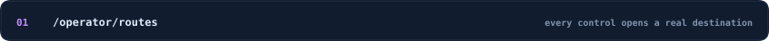
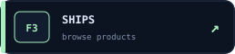
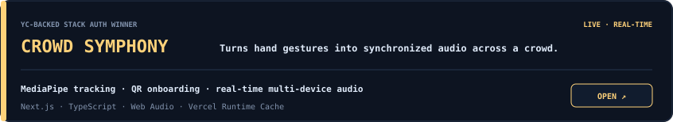

<a id="top"></a>

<p align="center">
  <picture>
    <source media="(max-width: 620px)" srcset="assets/hero-phone.svg">
    <source media="(prefers-color-scheme: light)" srcset="assets/hero-light.svg">
    
  </picture>
</p>

<a id="routes"></a>

<picture>
  <source media="(prefers-color-scheme: light)" srcset="assets/sections/routes-light.svg">
  
</picture>

<p align="center">
  <a href="https://tarang-portfolio-pink.vercel.app"><picture><source media="(prefers-color-scheme: light)" srcset="assets/keys/portfolio-light.svg"></picture></a>
  <a href="https://github.com/taranggoyal70?tab=repositories"><picture><source media="(prefers-color-scheme: light)" srcset="assets/keys/github-light.svg"></picture></a>
  <a href="#ships"><picture><source media="(prefers-color-scheme: light)" srcset="assets/keys/ships-light.svg"></picture></a>
</p>

<p align="center">
  <a href="https://arxiv.org/abs/2605.21504"><picture><source media="(prefers-color-scheme: light)" srcset="assets/keys/paper-light.svg"></picture></a>
  <a href="https://linkedin.com/in/tarang-goyal"><picture><source media="(prefers-color-scheme: light)" srcset="assets/keys/linkedin-light.svg"></picture></a>
  <a href="mailto:taranggoyal2000@gmail.com"><picture><source media="(prefers-color-scheme: light)" srcset="assets/keys/email-light.svg"></picture></a>
</p>

<a id="ships"></a>

<picture>
  <source media="(prefers-color-scheme: light)" srcset="assets/sections/ships-light.svg">
  
</picture>

<a href="https://locus-five-iota.vercel.app">
  <picture><source media="(prefers-color-scheme: light)" srcset="assets/ships/locus-light.svg"></picture>
</a>
<p align="right"><a href="https://locus-five-iota.vercel.app"><code>LIVE PRODUCT ↗</code></a>&nbsp;&nbsp;·&nbsp;&nbsp;<a href="https://github.com/taranggoyal70/locus"><code>SOURCE ↗</code></a></p>

<a href="https://gatekit.vercel.app">
  <picture><source media="(prefers-color-scheme: light)" srcset="assets/ships/gatekit-light.svg"></picture>
</a>
<p align="right"><a href="https://gatekit.vercel.app"><code>LIVE PRODUCT ↗</code></a>&nbsp;&nbsp;·&nbsp;&nbsp;<a href="https://github.com/taranggoyal70/gatekit"><code>SOURCE ↗</code></a></p>

<a href="https://morphic-murex.vercel.app">
  <picture><source media="(prefers-color-scheme: light)" srcset="assets/ships/morphic-light.svg"></picture>
</a>
<p align="right"><a href="https://morphic-murex.vercel.app"><code>LIVE PRODUCT ↗</code></a>&nbsp;&nbsp;·&nbsp;&nbsp;<a href="https://github.com/taranggoyal70/Morphic"><code>SOURCE ↗</code></a></p>

<a href="https://crowd-symphony.vercel.app">
  <picture><source media="(prefers-color-scheme: light)" srcset="assets/ships/crowd-light.svg"></picture>
</a>
<p align="right"><a href="https://crowd-symphony.vercel.app"><code>LIVE PRODUCT ↗</code></a>&nbsp;&nbsp;·&nbsp;&nbsp;<a href="https://github.com/taranggoyal70/crowd-symphony"><code>SOURCE ↗</code></a></p>

<a id="proof"></a>

<picture>
  <source media="(prefers-color-scheme: light)" srcset="assets/sections/proof-light.svg">
  
</picture>

<picture>
  <source media="(prefers-color-scheme: light)" srcset="assets/proof-light.svg">
  
</picture>

<p align="center">
  <a href="https://arxiv.org/abs/2605.21504"><code>READ THE PAPER ↗</code></a>
  &nbsp;&nbsp;·&nbsp;&nbsp;
  <a href="https://tarang-portfolio-pink.vercel.app"><code>OPEN FULL PORTFOLIO ↗</code></a>
</p>

<a id="operator"></a>

<picture>
  <source media="(prefers-color-scheme: light)" srcset="assets/sections/operator-light.svg">
  
</picture>

```text
tarang@builder:~$ cat /etc/operator.conf

product     = ambiguous problem -> working system -> real user feedback
production  = owned a full-stack AI platform used by students and staff
agents      = context routing, tool use, guardrails, evaluation, MCP
stack       = TypeScript, Python, React, Next.js, FastAPI, Postgres, AWS
research    = Chronos-2 multivariate forecasting -> arXiv:2605.21504
standard    = talk to users, test the edges, ship the whole thing
```

<details>
<summary><code>tarang@builder:~$ man tarang</code></summary>

```text
NAME
    tarang - AI product engineer who likes ambiguous problems

SYNOPSIS
    tarang [idea] --build-end-to-end --talk-to-users --measure

DESCRIPTION
    Takes unclear product problems across the model, backend, frontend,
    integrations, deployment, and evaluation layers.

NOTES
    8x hackathon and competition winner.
    Published research on multivariate forecasting with foundation models.
    Sleep is available as an optional dependency.
```

</details>

<p align="center">
  <a href="#top"><code>↑ REATTACH TO TOP</code></a>
</p>

<p align="center"><sub>Rendered from <a href="scripts/render_profile.py">one dependency-free Python system</a> and refreshed by GitHub Actions.</sub></p>
