<a id="top"></a>
<!-- raw-source bonus: cat .plan, then email the word EVIDENCE. -->

<p align="center"><picture><source media="(max-width: 600px), (min-width: 768px) and (max-width: 900px)" srcset="assets/hero-phone.svg"><source media="(prefers-color-scheme: light)" srcset="assets/hero-light.svg"></picture></p>

<p align="center"><a href="man/tarang.1.md"><picture><source media="(max-width: 600px)" srcset="assets/chrome/key-f1.svg"><source media="(prefers-color-scheme: light)" srcset="assets/chrome/key-f1-light.svg"></picture></a><a href="https://locus-five-iota.vercel.app"><picture><source media="(max-width: 600px)" srcset="assets/chrome/key-f2.svg"><source media="(prefers-color-scheme: light)" srcset="assets/chrome/key-f2-light.svg"></picture></a><a href="mailto:taranggoyal2000@gmail.com"><picture><source media="(max-width: 600px)" srcset="assets/chrome/key-f3.svg"><source media="(prefers-color-scheme: light)" srcset="assets/chrome/key-f3-light.svg"></picture></a><a href="https://linkedin.com/in/tarang-goyal"><picture><source media="(max-width: 600px)" srcset="assets/chrome/key-f4.svg"><source media="(prefers-color-scheme: light)" srcset="assets/chrome/key-f4-light.svg"></picture></a><a href="https://arxiv.org/abs/2605.21504"><picture><source media="(max-width: 600px)" srcset="assets/chrome/key-f5.svg"><source media="(prefers-color-scheme: light)" srcset="assets/chrome/key-f5-light.svg"></picture></a><a href="https://github.com/taranggoyal70?tab=repositories"><picture><source media="(max-width: 600px)" srcset="assets/chrome/key-f6.svg"><source media="(prefers-color-scheme: light)" srcset="assets/chrome/key-f6-light.svg"></picture></a><a href="https://tarang-portfolio-pink.vercel.app"><picture><source media="(max-width: 600px)" srcset="assets/chrome/key-f7.svg"><source media="(prefers-color-scheme: light)" srcset="assets/chrome/key-f7-light.svg"></picture></a></p>

<a id="ships"></a>
<p><a href="#fsck"><picture><source media="(max-width: 600px)" srcset="assets/chrome/bar-1-phone.svg"><source media="(prefers-color-scheme: light)" srcset="assets/chrome/bar-1-light.svg"></picture></a></p>

<!-- HACKLOG:START -->
<p align="center"><a href="https://github.com/taranggoyal70/tickmark"><picture><source media="(max-width: 600px)" srcset="assets/ships/tickmark-phone.svg"><source media="(prefers-color-scheme: light)" srcset="assets/ships/tickmark-light.svg"></picture></a><a href="https://github.com/taranggoyal70/locus"><picture><source media="(max-width: 600px)" srcset="assets/ships/locus-phone.svg"><source media="(prefers-color-scheme: light)" srcset="assets/ships/locus-light.svg"></picture></a><br>
<a href="https://github.com/taranggoyal70/Morphic"><picture><source media="(max-width: 600px)" srcset="assets/ships/morphic-phone.svg"><source media="(prefers-color-scheme: light)" srcset="assets/ships/morphic-light.svg"></picture></a><a href="https://github.com/taranggoyal70/Studentlytics"><picture><source media="(max-width: 600px)" srcset="assets/ships/studentlytics-phone.svg"><source media="(prefers-color-scheme: light)" srcset="assets/ships/studentlytics-light.svg"></picture></a><br>
<a href="https://github.com/taranggoyal70/a10-ai-firewall-hackathon-2025"><picture><source media="(max-width: 600px)" srcset="assets/ships/ai-firewall-phone.svg"><source media="(prefers-color-scheme: light)" srcset="assets/ships/ai-firewall-light.svg"></picture></a></p>
<!-- HACKLOG:END -->

<a id="fsck"></a>
<p><a href="#etc"><picture><source media="(max-width: 600px)" srcset="assets/chrome/bar-2-phone.svg"><source media="(prefers-color-scheme: light)" srcset="assets/chrome/bar-2-light.svg"></picture></a></p>

<!-- FSCK:START -->
<p>
<picture><source media="(max-width: 600px)" srcset="assets/fsck/panel-0-phone.svg"><source media="(prefers-color-scheme: light)" srcset="assets/fsck/panel-0-light.svg"></picture><picture><source media="(max-width: 600px)" srcset="assets/fsck/tiles/dark/cols.svg"><source media="(prefers-color-scheme: light)" srcset="assets/fsck/tiles/light/cols.svg"></picture><br>
<picture><source media="(max-width: 600px)" srcset="assets/fsck/tiles/dark/r1.svg"><source media="(prefers-color-scheme: light)" srcset="assets/fsck/tiles/light/r1.svg"></picture><a href="https://github.com/taranggoyal70/taranggoyal70/issues/new?title=atlasd%7Cfsck%7CA1&amp;body=Submit+this+issue+as-is+to+scan+sector+A1+of+Macintosh+HD.%0AThe+single-threaded+diskutil+demo+will+ack+with+an+eyes+reaction+and+redraw+the+board+in+about+a+minute."><picture><source media="(max-width: 600px)" srcset="assets/fsck/tiles/dark/hidden.svg"><source media="(prefers-color-scheme: light)" srcset="assets/fsck/tiles/light/hidden.svg"></picture></a><a href="https://github.com/taranggoyal70/taranggoyal70/issues/new?title=atlasd%7Cfsck%7CB1&amp;body=Submit+this+issue+as-is+to+scan+sector+B1+of+Macintosh+HD.%0AThe+single-threaded+diskutil+demo+will+ack+with+an+eyes+reaction+and+redraw+the+board+in+about+a+minute."><picture><source media="(max-width: 600px)" srcset="assets/fsck/tiles/dark/hidden.svg"><source media="(prefers-color-scheme: light)" srcset="assets/fsck/tiles/light/hidden.svg"></picture></a><a href="https://github.com/taranggoyal70/taranggoyal70/issues/new?title=atlasd%7Cfsck%7CC1&amp;body=Submit+this+issue+as-is+to+scan+sector+C1+of+Macintosh+HD.%0AThe+single-threaded+diskutil+demo+will+ack+with+an+eyes+reaction+and+redraw+the+board+in+about+a+minute."><picture><source media="(max-width: 600px)" srcset="assets/fsck/tiles/dark/hidden.svg"><source media="(prefers-color-scheme: light)" srcset="assets/fsck/tiles/light/hidden.svg"></picture></a><a href="https://github.com/taranggoyal70/taranggoyal70/issues/new?title=atlasd%7Cfsck%7CD1&amp;body=Submit+this+issue+as-is+to+scan+sector+D1+of+Macintosh+HD.%0AThe+single-threaded+diskutil+demo+will+ack+with+an+eyes+reaction+and+redraw+the+board+in+about+a+minute."><picture><source media="(max-width: 600px)" srcset="assets/fsck/tiles/dark/hidden.svg"><source media="(prefers-color-scheme: light)" srcset="assets/fsck/tiles/light/hidden.svg"></picture></a><a href="https://github.com/taranggoyal70/taranggoyal70/issues/new?title=atlasd%7Cfsck%7CE1&amp;body=Submit+this+issue+as-is+to+scan+sector+E1+of+Macintosh+HD.%0AThe+single-threaded+diskutil+demo+will+ack+with+an+eyes+reaction+and+redraw+the+board+in+about+a+minute."><picture><source media="(max-width: 600px)" srcset="assets/fsck/tiles/dark/hidden.svg"><source media="(prefers-color-scheme: light)" srcset="assets/fsck/tiles/light/hidden.svg"></picture></a><a href="https://github.com/taranggoyal70/taranggoyal70/issues/new?title=atlasd%7Cfsck%7CF1&amp;body=Submit+this+issue+as-is+to+scan+sector+F1+of+Macintosh+HD.%0AThe+single-threaded+diskutil+demo+will+ack+with+an+eyes+reaction+and+redraw+the+board+in+about+a+minute."><picture><source media="(max-width: 600px)" srcset="assets/fsck/tiles/dark/hidden.svg"><source media="(prefers-color-scheme: light)" srcset="assets/fsck/tiles/light/hidden.svg"></picture></a><a href="https://github.com/taranggoyal70/taranggoyal70/issues/new?title=atlasd%7Cfsck%7CG1&amp;body=Submit+this+issue+as-is+to+scan+sector+G1+of+Macintosh+HD.%0AThe+single-threaded+diskutil+demo+will+ack+with+an+eyes+reaction+and+redraw+the+board+in+about+a+minute."><picture><source media="(max-width: 600px)" srcset="assets/fsck/tiles/dark/hidden.svg"><source media="(prefers-color-scheme: light)" srcset="assets/fsck/tiles/light/hidden.svg"></picture></a><a href="https://github.com/taranggoyal70/taranggoyal70/issues/new?title=atlasd%7Cfsck%7CH1&amp;body=Submit+this+issue+as-is+to+scan+sector+H1+of+Macintosh+HD.%0AThe+single-threaded+diskutil+demo+will+ack+with+an+eyes+reaction+and+redraw+the+board+in+about+a+minute."><picture><source media="(max-width: 600px)" srcset="assets/fsck/tiles/dark/hidden.svg"><source media="(prefers-color-scheme: light)" srcset="assets/fsck/tiles/light/hidden.svg"></picture></a><a href="https://github.com/taranggoyal70/taranggoyal70/issues/new?title=atlasd%7Cfsck%7CI1&amp;body=Submit+this+issue+as-is+to+scan+sector+I1+of+Macintosh+HD.%0AThe+single-threaded+diskutil+demo+will+ack+with+an+eyes+reaction+and+redraw+the+board+in+about+a+minute."><picture><source media="(max-width: 600px)" srcset="assets/fsck/tiles/dark/hidden.svg"><source media="(prefers-color-scheme: light)" srcset="assets/fsck/tiles/light/hidden.svg"></picture></a><picture><source media="(max-width: 600px)" srcset="assets/fsck/tiles/dark/edge.svg"><source media="(prefers-color-scheme: light)" srcset="assets/fsck/tiles/light/edge.svg"></picture><br>
<picture><source media="(max-width: 600px)" srcset="assets/fsck/tiles/dark/r2.svg"><source media="(prefers-color-scheme: light)" srcset="assets/fsck/tiles/light/r2.svg"></picture><a href="https://github.com/taranggoyal70/taranggoyal70/issues/new?title=atlasd%7Cfsck%7CA2&amp;body=Submit+this+issue+as-is+to+scan+sector+A2+of+Macintosh+HD.%0AThe+single-threaded+diskutil+demo+will+ack+with+an+eyes+reaction+and+redraw+the+board+in+about+a+minute."><picture><source media="(max-width: 600px)" srcset="assets/fsck/tiles/dark/hidden.svg"><source media="(prefers-color-scheme: light)" srcset="assets/fsck/tiles/light/hidden.svg"></picture></a><a href="https://github.com/taranggoyal70/taranggoyal70/issues/new?title=atlasd%7Cfsck%7CB2&amp;body=Submit+this+issue+as-is+to+scan+sector+B2+of+Macintosh+HD.%0AThe+single-threaded+diskutil+demo+will+ack+with+an+eyes+reaction+and+redraw+the+board+in+about+a+minute."><picture><source media="(max-width: 600px)" srcset="assets/fsck/tiles/dark/hidden.svg"><source media="(prefers-color-scheme: light)" srcset="assets/fsck/tiles/light/hidden.svg"></picture></a><a href="https://github.com/taranggoyal70/taranggoyal70/issues/new?title=atlasd%7Cfsck%7CC2&amp;body=Submit+this+issue+as-is+to+scan+sector+C2+of+Macintosh+HD.%0AThe+single-threaded+diskutil+demo+will+ack+with+an+eyes+reaction+and+redraw+the+board+in+about+a+minute."><picture><source media="(max-width: 600px)" srcset="assets/fsck/tiles/dark/hidden.svg"><source media="(prefers-color-scheme: light)" srcset="assets/fsck/tiles/light/hidden.svg"></picture></a><a href="https://github.com/taranggoyal70/taranggoyal70/issues/new?title=atlasd%7Cfsck%7CD2&amp;body=Submit+this+issue+as-is+to+scan+sector+D2+of+Macintosh+HD.%0AThe+single-threaded+diskutil+demo+will+ack+with+an+eyes+reaction+and+redraw+the+board+in+about+a+minute."><picture><source media="(max-width: 600px)" srcset="assets/fsck/tiles/dark/hidden.svg"><source media="(prefers-color-scheme: light)" srcset="assets/fsck/tiles/light/hidden.svg"></picture></a><a href="https://github.com/taranggoyal70/taranggoyal70/issues/new?title=atlasd%7Cfsck%7CE2&amp;body=Submit+this+issue+as-is+to+scan+sector+E2+of+Macintosh+HD.%0AThe+single-threaded+diskutil+demo+will+ack+with+an+eyes+reaction+and+redraw+the+board+in+about+a+minute."><picture><source media="(max-width: 600px)" srcset="assets/fsck/tiles/dark/hidden.svg"><source media="(prefers-color-scheme: light)" srcset="assets/fsck/tiles/light/hidden.svg"></picture></a><a href="https://github.com/taranggoyal70/taranggoyal70/issues/new?title=atlasd%7Cfsck%7CF2&amp;body=Submit+this+issue+as-is+to+scan+sector+F2+of+Macintosh+HD.%0AThe+single-threaded+diskutil+demo+will+ack+with+an+eyes+reaction+and+redraw+the+board+in+about+a+minute."><picture><source media="(max-width: 600px)" srcset="assets/fsck/tiles/dark/hidden.svg"><source media="(prefers-color-scheme: light)" srcset="assets/fsck/tiles/light/hidden.svg"></picture></a><a href="https://github.com/taranggoyal70/taranggoyal70/issues/new?title=atlasd%7Cfsck%7CG2&amp;body=Submit+this+issue+as-is+to+scan+sector+G2+of+Macintosh+HD.%0AThe+single-threaded+diskutil+demo+will+ack+with+an+eyes+reaction+and+redraw+the+board+in+about+a+minute."><picture><source media="(max-width: 600px)" srcset="assets/fsck/tiles/dark/hidden.svg"><source media="(prefers-color-scheme: light)" srcset="assets/fsck/tiles/light/hidden.svg"></picture></a><a href="https://github.com/taranggoyal70/taranggoyal70/issues/new?title=atlasd%7Cfsck%7CH2&amp;body=Submit+this+issue+as-is+to+scan+sector+H2+of+Macintosh+HD.%0AThe+single-threaded+diskutil+demo+will+ack+with+an+eyes+reaction+and+redraw+the+board+in+about+a+minute."><picture><source media="(max-width: 600px)" srcset="assets/fsck/tiles/dark/hidden.svg"><source media="(prefers-color-scheme: light)" srcset="assets/fsck/tiles/light/hidden.svg"></picture></a><a href="https://github.com/taranggoyal70/taranggoyal70/issues/new?title=atlasd%7Cfsck%7CI2&amp;body=Submit+this+issue+as-is+to+scan+sector+I2+of+Macintosh+HD.%0AThe+single-threaded+diskutil+demo+will+ack+with+an+eyes+reaction+and+redraw+the+board+in+about+a+minute."><picture><source media="(max-width: 600px)" srcset="assets/fsck/tiles/dark/hidden.svg"><source media="(prefers-color-scheme: light)" srcset="assets/fsck/tiles/light/hidden.svg"></picture></a><picture><source media="(max-width: 600px)" srcset="assets/fsck/tiles/dark/edge.svg"><source media="(prefers-color-scheme: light)" srcset="assets/fsck/tiles/light/edge.svg"></picture><br>
<picture><source media="(max-width: 600px)" srcset="assets/fsck/tiles/dark/r3.svg"><source media="(prefers-color-scheme: light)" srcset="assets/fsck/tiles/light/r3.svg"></picture><a href="https://github.com/taranggoyal70/taranggoyal70/issues/new?title=atlasd%7Cfsck%7CA3&amp;body=Submit+this+issue+as-is+to+scan+sector+A3+of+Macintosh+HD.%0AThe+single-threaded+diskutil+demo+will+ack+with+an+eyes+reaction+and+redraw+the+board+in+about+a+minute."><picture><source media="(max-width: 600px)" srcset="assets/fsck/tiles/dark/hidden.svg"><source media="(prefers-color-scheme: light)" srcset="assets/fsck/tiles/light/hidden.svg"></picture></a><a href="https://github.com/taranggoyal70/taranggoyal70/issues/new?title=atlasd%7Cfsck%7CB3&amp;body=Submit+this+issue+as-is+to+scan+sector+B3+of+Macintosh+HD.%0AThe+single-threaded+diskutil+demo+will+ack+with+an+eyes+reaction+and+redraw+the+board+in+about+a+minute."><picture><source media="(max-width: 600px)" srcset="assets/fsck/tiles/dark/hidden.svg"><source media="(prefers-color-scheme: light)" srcset="assets/fsck/tiles/light/hidden.svg"></picture></a><a href="https://github.com/taranggoyal70/taranggoyal70/issues/new?title=atlasd%7Cfsck%7CC3&amp;body=Submit+this+issue+as-is+to+scan+sector+C3+of+Macintosh+HD.%0AThe+single-threaded+diskutil+demo+will+ack+with+an+eyes+reaction+and+redraw+the+board+in+about+a+minute."><picture><source media="(max-width: 600px)" srcset="assets/fsck/tiles/dark/hidden.svg"><source media="(prefers-color-scheme: light)" srcset="assets/fsck/tiles/light/hidden.svg"></picture></a><a href="https://github.com/taranggoyal70/taranggoyal70/issues/new?title=atlasd%7Cfsck%7CD3&amp;body=Submit+this+issue+as-is+to+scan+sector+D3+of+Macintosh+HD.%0AThe+single-threaded+diskutil+demo+will+ack+with+an+eyes+reaction+and+redraw+the+board+in+about+a+minute."><picture><source media="(max-width: 600px)" srcset="assets/fsck/tiles/dark/hidden.svg"><source media="(prefers-color-scheme: light)" srcset="assets/fsck/tiles/light/hidden.svg"></picture></a><a href="https://github.com/taranggoyal70/taranggoyal70/issues/new?title=atlasd%7Cfsck%7CE3&amp;body=Submit+this+issue+as-is+to+scan+sector+E3+of+Macintosh+HD.%0AThe+single-threaded+diskutil+demo+will+ack+with+an+eyes+reaction+and+redraw+the+board+in+about+a+minute."><picture><source media="(max-width: 600px)" srcset="assets/fsck/tiles/dark/hidden.svg"><source media="(prefers-color-scheme: light)" srcset="assets/fsck/tiles/light/hidden.svg"></picture></a><a href="https://github.com/taranggoyal70/taranggoyal70/issues/new?title=atlasd%7Cfsck%7CF3&amp;body=Submit+this+issue+as-is+to+scan+sector+F3+of+Macintosh+HD.%0AThe+single-threaded+diskutil+demo+will+ack+with+an+eyes+reaction+and+redraw+the+board+in+about+a+minute."><picture><source media="(max-width: 600px)" srcset="assets/fsck/tiles/dark/hidden.svg"><source media="(prefers-color-scheme: light)" srcset="assets/fsck/tiles/light/hidden.svg"></picture></a><a href="https://github.com/taranggoyal70/taranggoyal70/issues/new?title=atlasd%7Cfsck%7CG3&amp;body=Submit+this+issue+as-is+to+scan+sector+G3+of+Macintosh+HD.%0AThe+single-threaded+diskutil+demo+will+ack+with+an+eyes+reaction+and+redraw+the+board+in+about+a+minute."><picture><source media="(max-width: 600px)" srcset="assets/fsck/tiles/dark/hidden.svg"><source media="(prefers-color-scheme: light)" srcset="assets/fsck/tiles/light/hidden.svg"></picture></a><a href="https://github.com/taranggoyal70/taranggoyal70/issues/new?title=atlasd%7Cfsck%7CH3&amp;body=Submit+this+issue+as-is+to+scan+sector+H3+of+Macintosh+HD.%0AThe+single-threaded+diskutil+demo+will+ack+with+an+eyes+reaction+and+redraw+the+board+in+about+a+minute."><picture><source media="(max-width: 600px)" srcset="assets/fsck/tiles/dark/hidden.svg"><source media="(prefers-color-scheme: light)" srcset="assets/fsck/tiles/light/hidden.svg"></picture></a><a href="https://github.com/taranggoyal70/taranggoyal70/issues/new?title=atlasd%7Cfsck%7CI3&amp;body=Submit+this+issue+as-is+to+scan+sector+I3+of+Macintosh+HD.%0AThe+single-threaded+diskutil+demo+will+ack+with+an+eyes+reaction+and+redraw+the+board+in+about+a+minute."><picture><source media="(max-width: 600px)" srcset="assets/fsck/tiles/dark/hidden.svg"><source media="(prefers-color-scheme: light)" srcset="assets/fsck/tiles/light/hidden.svg"></picture></a><picture><source media="(max-width: 600px)" srcset="assets/fsck/tiles/dark/edge.svg"><source media="(prefers-color-scheme: light)" srcset="assets/fsck/tiles/light/edge.svg"></picture><br>
<picture><source media="(max-width: 600px)" srcset="assets/fsck/tiles/dark/r4.svg"><source media="(prefers-color-scheme: light)" srcset="assets/fsck/tiles/light/r4.svg"></picture><a href="https://github.com/taranggoyal70/taranggoyal70/issues/new?title=atlasd%7Cfsck%7CA4&amp;body=Submit+this+issue+as-is+to+scan+sector+A4+of+Macintosh+HD.%0AThe+single-threaded+diskutil+demo+will+ack+with+an+eyes+reaction+and+redraw+the+board+in+about+a+minute."><picture><source media="(max-width: 600px)" srcset="assets/fsck/tiles/dark/hidden.svg"><source media="(prefers-color-scheme: light)" srcset="assets/fsck/tiles/light/hidden.svg"></picture></a><a href="https://github.com/taranggoyal70/taranggoyal70/issues/new?title=atlasd%7Cfsck%7CB4&amp;body=Submit+this+issue+as-is+to+scan+sector+B4+of+Macintosh+HD.%0AThe+single-threaded+diskutil+demo+will+ack+with+an+eyes+reaction+and+redraw+the+board+in+about+a+minute."><picture><source media="(max-width: 600px)" srcset="assets/fsck/tiles/dark/hidden.svg"><source media="(prefers-color-scheme: light)" srcset="assets/fsck/tiles/light/hidden.svg"></picture></a><a href="https://github.com/taranggoyal70/taranggoyal70/issues/new?title=atlasd%7Cfsck%7CC4&amp;body=Submit+this+issue+as-is+to+scan+sector+C4+of+Macintosh+HD.%0AThe+single-threaded+diskutil+demo+will+ack+with+an+eyes+reaction+and+redraw+the+board+in+about+a+minute."><picture><source media="(max-width: 600px)" srcset="assets/fsck/tiles/dark/hidden.svg"><source media="(prefers-color-scheme: light)" srcset="assets/fsck/tiles/light/hidden.svg"></picture></a><a href="https://github.com/taranggoyal70/taranggoyal70/issues/new?title=atlasd%7Cfsck%7CD4&amp;body=Submit+this+issue+as-is+to+scan+sector+D4+of+Macintosh+HD.%0AThe+single-threaded+diskutil+demo+will+ack+with+an+eyes+reaction+and+redraw+the+board+in+about+a+minute."><picture><source media="(max-width: 600px)" srcset="assets/fsck/tiles/dark/hidden.svg"><source media="(prefers-color-scheme: light)" srcset="assets/fsck/tiles/light/hidden.svg"></picture></a><a href="https://github.com/taranggoyal70/taranggoyal70/issues/new?title=atlasd%7Cfsck%7CE4&amp;body=Submit+this+issue+as-is+to+scan+sector+E4+of+Macintosh+HD.%0AThe+single-threaded+diskutil+demo+will+ack+with+an+eyes+reaction+and+redraw+the+board+in+about+a+minute."><picture><source media="(max-width: 600px)" srcset="assets/fsck/tiles/dark/hidden.svg"><source media="(prefers-color-scheme: light)" srcset="assets/fsck/tiles/light/hidden.svg"></picture></a><a href="https://github.com/taranggoyal70/taranggoyal70/issues/new?title=atlasd%7Cfsck%7CF4&amp;body=Submit+this+issue+as-is+to+scan+sector+F4+of+Macintosh+HD.%0AThe+single-threaded+diskutil+demo+will+ack+with+an+eyes+reaction+and+redraw+the+board+in+about+a+minute."><picture><source media="(max-width: 600px)" srcset="assets/fsck/tiles/dark/hidden.svg"><source media="(prefers-color-scheme: light)" srcset="assets/fsck/tiles/light/hidden.svg"></picture></a><a href="https://github.com/taranggoyal70/taranggoyal70/issues/new?title=atlasd%7Cfsck%7CG4&amp;body=Submit+this+issue+as-is+to+scan+sector+G4+of+Macintosh+HD.%0AThe+single-threaded+diskutil+demo+will+ack+with+an+eyes+reaction+and+redraw+the+board+in+about+a+minute."><picture><source media="(max-width: 600px)" srcset="assets/fsck/tiles/dark/hidden.svg"><source media="(prefers-color-scheme: light)" srcset="assets/fsck/tiles/light/hidden.svg"></picture></a><a href="https://github.com/taranggoyal70/taranggoyal70/issues/new?title=atlasd%7Cfsck%7CH4&amp;body=Submit+this+issue+as-is+to+scan+sector+H4+of+Macintosh+HD.%0AThe+single-threaded+diskutil+demo+will+ack+with+an+eyes+reaction+and+redraw+the+board+in+about+a+minute."><picture><source media="(max-width: 600px)" srcset="assets/fsck/tiles/dark/hidden.svg"><source media="(prefers-color-scheme: light)" srcset="assets/fsck/tiles/light/hidden.svg"></picture></a><a href="https://github.com/taranggoyal70/taranggoyal70/issues/new?title=atlasd%7Cfsck%7CI4&amp;body=Submit+this+issue+as-is+to+scan+sector+I4+of+Macintosh+HD.%0AThe+single-threaded+diskutil+demo+will+ack+with+an+eyes+reaction+and+redraw+the+board+in+about+a+minute."><picture><source media="(max-width: 600px)" srcset="assets/fsck/tiles/dark/hidden.svg"><source media="(prefers-color-scheme: light)" srcset="assets/fsck/tiles/light/hidden.svg"></picture></a><picture><source media="(max-width: 600px)" srcset="assets/fsck/tiles/dark/edge.svg"><source media="(prefers-color-scheme: light)" srcset="assets/fsck/tiles/light/edge.svg"></picture><br>
<picture><source media="(max-width: 600px)" srcset="assets/fsck/tiles/dark/r5.svg"><source media="(prefers-color-scheme: light)" srcset="assets/fsck/tiles/light/r5.svg"></picture><a href="https://github.com/taranggoyal70/taranggoyal70/issues/new?title=atlasd%7Cfsck%7CA5&amp;body=Submit+this+issue+as-is+to+scan+sector+A5+of+Macintosh+HD.%0AThe+single-threaded+diskutil+demo+will+ack+with+an+eyes+reaction+and+redraw+the+board+in+about+a+minute."><picture><source media="(max-width: 600px)" srcset="assets/fsck/tiles/dark/hidden.svg"><source media="(prefers-color-scheme: light)" srcset="assets/fsck/tiles/light/hidden.svg"></picture></a><a href="https://github.com/taranggoyal70/taranggoyal70/issues/new?title=atlasd%7Cfsck%7CB5&amp;body=Submit+this+issue+as-is+to+scan+sector+B5+of+Macintosh+HD.%0AThe+single-threaded+diskutil+demo+will+ack+with+an+eyes+reaction+and+redraw+the+board+in+about+a+minute."><picture><source media="(max-width: 600px)" srcset="assets/fsck/tiles/dark/hidden.svg"><source media="(prefers-color-scheme: light)" srcset="assets/fsck/tiles/light/hidden.svg"></picture></a><a href="https://github.com/taranggoyal70/taranggoyal70/issues/new?title=atlasd%7Cfsck%7CC5&amp;body=Submit+this+issue+as-is+to+scan+sector+C5+of+Macintosh+HD.%0AThe+single-threaded+diskutil+demo+will+ack+with+an+eyes+reaction+and+redraw+the+board+in+about+a+minute."><picture><source media="(max-width: 600px)" srcset="assets/fsck/tiles/dark/hidden.svg"><source media="(prefers-color-scheme: light)" srcset="assets/fsck/tiles/light/hidden.svg"></picture></a><a href="https://github.com/taranggoyal70/taranggoyal70/issues/new?title=atlasd%7Cfsck%7CD5&amp;body=Submit+this+issue+as-is+to+scan+sector+D5+of+Macintosh+HD.%0AThe+single-threaded+diskutil+demo+will+ack+with+an+eyes+reaction+and+redraw+the+board+in+about+a+minute."><picture><source media="(max-width: 600px)" srcset="assets/fsck/tiles/dark/hidden.svg"><source media="(prefers-color-scheme: light)" srcset="assets/fsck/tiles/light/hidden.svg"></picture></a><a href="https://github.com/taranggoyal70/taranggoyal70/issues/new?title=atlasd%7Cfsck%7CE5&amp;body=Submit+this+issue+as-is+to+scan+sector+E5+of+Macintosh+HD.%0AThe+single-threaded+diskutil+demo+will+ack+with+an+eyes+reaction+and+redraw+the+board+in+about+a+minute."><picture><source media="(max-width: 600px)" srcset="assets/fsck/tiles/dark/hidden.svg"><source media="(prefers-color-scheme: light)" srcset="assets/fsck/tiles/light/hidden.svg"></picture></a><a href="https://github.com/taranggoyal70/taranggoyal70/issues/new?title=atlasd%7Cfsck%7CF5&amp;body=Submit+this+issue+as-is+to+scan+sector+F5+of+Macintosh+HD.%0AThe+single-threaded+diskutil+demo+will+ack+with+an+eyes+reaction+and+redraw+the+board+in+about+a+minute."><picture><source media="(max-width: 600px)" srcset="assets/fsck/tiles/dark/hidden.svg"><source media="(prefers-color-scheme: light)" srcset="assets/fsck/tiles/light/hidden.svg"></picture></a><a href="https://github.com/taranggoyal70/taranggoyal70/issues/new?title=atlasd%7Cfsck%7CG5&amp;body=Submit+this+issue+as-is+to+scan+sector+G5+of+Macintosh+HD.%0AThe+single-threaded+diskutil+demo+will+ack+with+an+eyes+reaction+and+redraw+the+board+in+about+a+minute."><picture><source media="(max-width: 600px)" srcset="assets/fsck/tiles/dark/hidden.svg"><source media="(prefers-color-scheme: light)" srcset="assets/fsck/tiles/light/hidden.svg"></picture></a><a href="https://github.com/taranggoyal70/taranggoyal70/issues/new?title=atlasd%7Cfsck%7CH5&amp;body=Submit+this+issue+as-is+to+scan+sector+H5+of+Macintosh+HD.%0AThe+single-threaded+diskutil+demo+will+ack+with+an+eyes+reaction+and+redraw+the+board+in+about+a+minute."><picture><source media="(max-width: 600px)" srcset="assets/fsck/tiles/dark/hidden.svg"><source media="(prefers-color-scheme: light)" srcset="assets/fsck/tiles/light/hidden.svg"></picture></a><a href="https://github.com/taranggoyal70/taranggoyal70/issues/new?title=atlasd%7Cfsck%7CI5&amp;body=Submit+this+issue+as-is+to+scan+sector+I5+of+Macintosh+HD.%0AThe+single-threaded+diskutil+demo+will+ack+with+an+eyes+reaction+and+redraw+the+board+in+about+a+minute."><picture><source media="(max-width: 600px)" srcset="assets/fsck/tiles/dark/hidden.svg"><source media="(prefers-color-scheme: light)" srcset="assets/fsck/tiles/light/hidden.svg"></picture></a><picture><source media="(max-width: 600px)" srcset="assets/fsck/tiles/dark/edge.svg"><source media="(prefers-color-scheme: light)" srcset="assets/fsck/tiles/light/edge.svg"></picture><br>
<picture><source media="(max-width: 600px)" srcset="assets/fsck/tiles/dark/r6.svg"><source media="(prefers-color-scheme: light)" srcset="assets/fsck/tiles/light/r6.svg"></picture><a href="https://github.com/taranggoyal70/taranggoyal70/issues/new?title=atlasd%7Cfsck%7CA6&amp;body=Submit+this+issue+as-is+to+scan+sector+A6+of+Macintosh+HD.%0AThe+single-threaded+diskutil+demo+will+ack+with+an+eyes+reaction+and+redraw+the+board+in+about+a+minute."><picture><source media="(max-width: 600px)" srcset="assets/fsck/tiles/dark/hidden.svg"><source media="(prefers-color-scheme: light)" srcset="assets/fsck/tiles/light/hidden.svg"></picture></a><a href="https://github.com/taranggoyal70/taranggoyal70/issues/new?title=atlasd%7Cfsck%7CB6&amp;body=Submit+this+issue+as-is+to+scan+sector+B6+of+Macintosh+HD.%0AThe+single-threaded+diskutil+demo+will+ack+with+an+eyes+reaction+and+redraw+the+board+in+about+a+minute."><picture><source media="(max-width: 600px)" srcset="assets/fsck/tiles/dark/hidden.svg"><source media="(prefers-color-scheme: light)" srcset="assets/fsck/tiles/light/hidden.svg"></picture></a><a href="https://github.com/taranggoyal70/taranggoyal70/issues/new?title=atlasd%7Cfsck%7CC6&amp;body=Submit+this+issue+as-is+to+scan+sector+C6+of+Macintosh+HD.%0AThe+single-threaded+diskutil+demo+will+ack+with+an+eyes+reaction+and+redraw+the+board+in+about+a+minute."><picture><source media="(max-width: 600px)" srcset="assets/fsck/tiles/dark/hidden.svg"><source media="(prefers-color-scheme: light)" srcset="assets/fsck/tiles/light/hidden.svg"></picture></a><a href="https://github.com/taranggoyal70/taranggoyal70/issues/new?title=atlasd%7Cfsck%7CD6&amp;body=Submit+this+issue+as-is+to+scan+sector+D6+of+Macintosh+HD.%0AThe+single-threaded+diskutil+demo+will+ack+with+an+eyes+reaction+and+redraw+the+board+in+about+a+minute."><picture><source media="(max-width: 600px)" srcset="assets/fsck/tiles/dark/hidden.svg"><source media="(prefers-color-scheme: light)" srcset="assets/fsck/tiles/light/hidden.svg"></picture></a><a href="https://github.com/taranggoyal70/taranggoyal70/issues/new?title=atlasd%7Cfsck%7CE6&amp;body=Submit+this+issue+as-is+to+scan+sector+E6+of+Macintosh+HD.%0AThe+single-threaded+diskutil+demo+will+ack+with+an+eyes+reaction+and+redraw+the+board+in+about+a+minute."><picture><source media="(max-width: 600px)" srcset="assets/fsck/tiles/dark/hidden.svg"><source media="(prefers-color-scheme: light)" srcset="assets/fsck/tiles/light/hidden.svg"></picture></a><a href="https://github.com/taranggoyal70/taranggoyal70/issues/new?title=atlasd%7Cfsck%7CF6&amp;body=Submit+this+issue+as-is+to+scan+sector+F6+of+Macintosh+HD.%0AThe+single-threaded+diskutil+demo+will+ack+with+an+eyes+reaction+and+redraw+the+board+in+about+a+minute."><picture><source media="(max-width: 600px)" srcset="assets/fsck/tiles/dark/hidden.svg"><source media="(prefers-color-scheme: light)" srcset="assets/fsck/tiles/light/hidden.svg"></picture></a><a href="https://github.com/taranggoyal70/taranggoyal70/issues/new?title=atlasd%7Cfsck%7CG6&amp;body=Submit+this+issue+as-is+to+scan+sector+G6+of+Macintosh+HD.%0AThe+single-threaded+diskutil+demo+will+ack+with+an+eyes+reaction+and+redraw+the+board+in+about+a+minute."><picture><source media="(max-width: 600px)" srcset="assets/fsck/tiles/dark/hidden.svg"><source media="(prefers-color-scheme: light)" srcset="assets/fsck/tiles/light/hidden.svg"></picture></a><a href="https://github.com/taranggoyal70/taranggoyal70/issues/new?title=atlasd%7Cfsck%7CH6&amp;body=Submit+this+issue+as-is+to+scan+sector+H6+of+Macintosh+HD.%0AThe+single-threaded+diskutil+demo+will+ack+with+an+eyes+reaction+and+redraw+the+board+in+about+a+minute."><picture><source media="(max-width: 600px)" srcset="assets/fsck/tiles/dark/hidden.svg"><source media="(prefers-color-scheme: light)" srcset="assets/fsck/tiles/light/hidden.svg"></picture></a><a href="https://github.com/taranggoyal70/taranggoyal70/issues/new?title=atlasd%7Cfsck%7CI6&amp;body=Submit+this+issue+as-is+to+scan+sector+I6+of+Macintosh+HD.%0AThe+single-threaded+diskutil+demo+will+ack+with+an+eyes+reaction+and+redraw+the+board+in+about+a+minute."><picture><source media="(max-width: 600px)" srcset="assets/fsck/tiles/dark/hidden.svg"><source media="(prefers-color-scheme: light)" srcset="assets/fsck/tiles/light/hidden.svg"></picture></a><picture><source media="(max-width: 600px)" srcset="assets/fsck/tiles/dark/edge.svg"><source media="(prefers-color-scheme: light)" srcset="assets/fsck/tiles/light/edge.svg"></picture><br>
<picture><source media="(max-width: 600px)" srcset="assets/fsck/tiles/dark/r7.svg"><source media="(prefers-color-scheme: light)" srcset="assets/fsck/tiles/light/r7.svg"></picture><a href="https://github.com/taranggoyal70/taranggoyal70/issues/new?title=atlasd%7Cfsck%7CA7&amp;body=Submit+this+issue+as-is+to+scan+sector+A7+of+Macintosh+HD.%0AThe+single-threaded+diskutil+demo+will+ack+with+an+eyes+reaction+and+redraw+the+board+in+about+a+minute."><picture><source media="(max-width: 600px)" srcset="assets/fsck/tiles/dark/hidden.svg"><source media="(prefers-color-scheme: light)" srcset="assets/fsck/tiles/light/hidden.svg"></picture></a><a href="https://github.com/taranggoyal70/taranggoyal70/issues/new?title=atlasd%7Cfsck%7CB7&amp;body=Submit+this+issue+as-is+to+scan+sector+B7+of+Macintosh+HD.%0AThe+single-threaded+diskutil+demo+will+ack+with+an+eyes+reaction+and+redraw+the+board+in+about+a+minute."><picture><source media="(max-width: 600px)" srcset="assets/fsck/tiles/dark/hidden.svg"><source media="(prefers-color-scheme: light)" srcset="assets/fsck/tiles/light/hidden.svg"></picture></a><a href="https://github.com/taranggoyal70/taranggoyal70/issues/new?title=atlasd%7Cfsck%7CC7&amp;body=Submit+this+issue+as-is+to+scan+sector+C7+of+Macintosh+HD.%0AThe+single-threaded+diskutil+demo+will+ack+with+an+eyes+reaction+and+redraw+the+board+in+about+a+minute."><picture><source media="(max-width: 600px)" srcset="assets/fsck/tiles/dark/hidden.svg"><source media="(prefers-color-scheme: light)" srcset="assets/fsck/tiles/light/hidden.svg"></picture></a><a href="https://github.com/taranggoyal70/taranggoyal70/issues/new?title=atlasd%7Cfsck%7CD7&amp;body=Submit+this+issue+as-is+to+scan+sector+D7+of+Macintosh+HD.%0AThe+single-threaded+diskutil+demo+will+ack+with+an+eyes+reaction+and+redraw+the+board+in+about+a+minute."><picture><source media="(max-width: 600px)" srcset="assets/fsck/tiles/dark/hidden.svg"><source media="(prefers-color-scheme: light)" srcset="assets/fsck/tiles/light/hidden.svg"></picture></a><a href="https://github.com/taranggoyal70/taranggoyal70/issues/new?title=atlasd%7Cfsck%7CE7&amp;body=Submit+this+issue+as-is+to+scan+sector+E7+of+Macintosh+HD.%0AThe+single-threaded+diskutil+demo+will+ack+with+an+eyes+reaction+and+redraw+the+board+in+about+a+minute."><picture><source media="(max-width: 600px)" srcset="assets/fsck/tiles/dark/hidden.svg"><source media="(prefers-color-scheme: light)" srcset="assets/fsck/tiles/light/hidden.svg"></picture></a><a href="https://github.com/taranggoyal70/taranggoyal70/issues/new?title=atlasd%7Cfsck%7CF7&amp;body=Submit+this+issue+as-is+to+scan+sector+F7+of+Macintosh+HD.%0AThe+single-threaded+diskutil+demo+will+ack+with+an+eyes+reaction+and+redraw+the+board+in+about+a+minute."><picture><source media="(max-width: 600px)" srcset="assets/fsck/tiles/dark/hidden.svg"><source media="(prefers-color-scheme: light)" srcset="assets/fsck/tiles/light/hidden.svg"></picture></a><a href="https://github.com/taranggoyal70/taranggoyal70/issues/new?title=atlasd%7Cfsck%7CG7&amp;body=Submit+this+issue+as-is+to+scan+sector+G7+of+Macintosh+HD.%0AThe+single-threaded+diskutil+demo+will+ack+with+an+eyes+reaction+and+redraw+the+board+in+about+a+minute."><picture><source media="(max-width: 600px)" srcset="assets/fsck/tiles/dark/hidden.svg"><source media="(prefers-color-scheme: light)" srcset="assets/fsck/tiles/light/hidden.svg"></picture></a><a href="https://github.com/taranggoyal70/taranggoyal70/issues/new?title=atlasd%7Cfsck%7CH7&amp;body=Submit+this+issue+as-is+to+scan+sector+H7+of+Macintosh+HD.%0AThe+single-threaded+diskutil+demo+will+ack+with+an+eyes+reaction+and+redraw+the+board+in+about+a+minute."><picture><source media="(max-width: 600px)" srcset="assets/fsck/tiles/dark/hidden.svg"><source media="(prefers-color-scheme: light)" srcset="assets/fsck/tiles/light/hidden.svg"></picture></a><a href="https://github.com/taranggoyal70/taranggoyal70/issues/new?title=atlasd%7Cfsck%7CI7&amp;body=Submit+this+issue+as-is+to+scan+sector+I7+of+Macintosh+HD.%0AThe+single-threaded+diskutil+demo+will+ack+with+an+eyes+reaction+and+redraw+the+board+in+about+a+minute."><picture><source media="(max-width: 600px)" srcset="assets/fsck/tiles/dark/hidden.svg"><source media="(prefers-color-scheme: light)" srcset="assets/fsck/tiles/light/hidden.svg"></picture></a><picture><source media="(max-width: 600px)" srcset="assets/fsck/tiles/dark/edge.svg"><source media="(prefers-color-scheme: light)" srcset="assets/fsck/tiles/light/edge.svg"></picture><br>
<picture><source media="(max-width: 600px)" srcset="assets/fsck/tiles/dark/r8.svg"><source media="(prefers-color-scheme: light)" srcset="assets/fsck/tiles/light/r8.svg"></picture><a href="https://github.com/taranggoyal70/taranggoyal70/issues/new?title=atlasd%7Cfsck%7CA8&amp;body=Submit+this+issue+as-is+to+scan+sector+A8+of+Macintosh+HD.%0AThe+single-threaded+diskutil+demo+will+ack+with+an+eyes+reaction+and+redraw+the+board+in+about+a+minute."><picture><source media="(max-width: 600px)" srcset="assets/fsck/tiles/dark/hidden.svg"><source media="(prefers-color-scheme: light)" srcset="assets/fsck/tiles/light/hidden.svg"></picture></a><a href="https://github.com/taranggoyal70/taranggoyal70/issues/new?title=atlasd%7Cfsck%7CB8&amp;body=Submit+this+issue+as-is+to+scan+sector+B8+of+Macintosh+HD.%0AThe+single-threaded+diskutil+demo+will+ack+with+an+eyes+reaction+and+redraw+the+board+in+about+a+minute."><picture><source media="(max-width: 600px)" srcset="assets/fsck/tiles/dark/hidden.svg"><source media="(prefers-color-scheme: light)" srcset="assets/fsck/tiles/light/hidden.svg"></picture></a><a href="https://github.com/taranggoyal70/taranggoyal70/issues/new?title=atlasd%7Cfsck%7CC8&amp;body=Submit+this+issue+as-is+to+scan+sector+C8+of+Macintosh+HD.%0AThe+single-threaded+diskutil+demo+will+ack+with+an+eyes+reaction+and+redraw+the+board+in+about+a+minute."><picture><source media="(max-width: 600px)" srcset="assets/fsck/tiles/dark/hidden.svg"><source media="(prefers-color-scheme: light)" srcset="assets/fsck/tiles/light/hidden.svg"></picture></a><a href="https://github.com/taranggoyal70/taranggoyal70/issues/new?title=atlasd%7Cfsck%7CD8&amp;body=Submit+this+issue+as-is+to+scan+sector+D8+of+Macintosh+HD.%0AThe+single-threaded+diskutil+demo+will+ack+with+an+eyes+reaction+and+redraw+the+board+in+about+a+minute."><picture><source media="(max-width: 600px)" srcset="assets/fsck/tiles/dark/hidden.svg"><source media="(prefers-color-scheme: light)" srcset="assets/fsck/tiles/light/hidden.svg"></picture></a><a href="https://github.com/taranggoyal70/taranggoyal70/issues/new?title=atlasd%7Cfsck%7CE8&amp;body=Submit+this+issue+as-is+to+scan+sector+E8+of+Macintosh+HD.%0AThe+single-threaded+diskutil+demo+will+ack+with+an+eyes+reaction+and+redraw+the+board+in+about+a+minute."><picture><source media="(max-width: 600px)" srcset="assets/fsck/tiles/dark/hidden.svg"><source media="(prefers-color-scheme: light)" srcset="assets/fsck/tiles/light/hidden.svg"></picture></a><a href="https://github.com/taranggoyal70/taranggoyal70/issues/new?title=atlasd%7Cfsck%7CF8&amp;body=Submit+this+issue+as-is+to+scan+sector+F8+of+Macintosh+HD.%0AThe+single-threaded+diskutil+demo+will+ack+with+an+eyes+reaction+and+redraw+the+board+in+about+a+minute."><picture><source media="(max-width: 600px)" srcset="assets/fsck/tiles/dark/hidden.svg"><source media="(prefers-color-scheme: light)" srcset="assets/fsck/tiles/light/hidden.svg"></picture></a><a href="https://github.com/taranggoyal70/taranggoyal70/issues/new?title=atlasd%7Cfsck%7CG8&amp;body=Submit+this+issue+as-is+to+scan+sector+G8+of+Macintosh+HD.%0AThe+single-threaded+diskutil+demo+will+ack+with+an+eyes+reaction+and+redraw+the+board+in+about+a+minute."><picture><source media="(max-width: 600px)" srcset="assets/fsck/tiles/dark/hidden.svg"><source media="(prefers-color-scheme: light)" srcset="assets/fsck/tiles/light/hidden.svg"></picture></a><a href="https://github.com/taranggoyal70/taranggoyal70/issues/new?title=atlasd%7Cfsck%7CH8&amp;body=Submit+this+issue+as-is+to+scan+sector+H8+of+Macintosh+HD.%0AThe+single-threaded+diskutil+demo+will+ack+with+an+eyes+reaction+and+redraw+the+board+in+about+a+minute."><picture><source media="(max-width: 600px)" srcset="assets/fsck/tiles/dark/hidden.svg"><source media="(prefers-color-scheme: light)" srcset="assets/fsck/tiles/light/hidden.svg"></picture></a><a href="https://github.com/taranggoyal70/taranggoyal70/issues/new?title=atlasd%7Cfsck%7CI8&amp;body=Submit+this+issue+as-is+to+scan+sector+I8+of+Macintosh+HD.%0AThe+single-threaded+diskutil+demo+will+ack+with+an+eyes+reaction+and+redraw+the+board+in+about+a+minute."><picture><source media="(max-width: 600px)" srcset="assets/fsck/tiles/dark/hidden.svg"><source media="(prefers-color-scheme: light)" srcset="assets/fsck/tiles/light/hidden.svg"></picture></a><picture><source media="(max-width: 600px)" srcset="assets/fsck/tiles/dark/edge.svg"><source media="(prefers-color-scheme: light)" srcset="assets/fsck/tiles/light/edge.svg"></picture><br>
<picture><source media="(max-width: 600px)" srcset="assets/fsck/tiles/dark/r9.svg"><source media="(prefers-color-scheme: light)" srcset="assets/fsck/tiles/light/r9.svg"></picture><a href="https://github.com/taranggoyal70/taranggoyal70/issues/new?title=atlasd%7Cfsck%7CA9&amp;body=Submit+this+issue+as-is+to+scan+sector+A9+of+Macintosh+HD.%0AThe+single-threaded+diskutil+demo+will+ack+with+an+eyes+reaction+and+redraw+the+board+in+about+a+minute."><picture><source media="(max-width: 600px)" srcset="assets/fsck/tiles/dark/hidden.svg"><source media="(prefers-color-scheme: light)" srcset="assets/fsck/tiles/light/hidden.svg"></picture></a><a href="https://github.com/taranggoyal70/taranggoyal70/issues/new?title=atlasd%7Cfsck%7CB9&amp;body=Submit+this+issue+as-is+to+scan+sector+B9+of+Macintosh+HD.%0AThe+single-threaded+diskutil+demo+will+ack+with+an+eyes+reaction+and+redraw+the+board+in+about+a+minute."><picture><source media="(max-width: 600px)" srcset="assets/fsck/tiles/dark/hidden.svg"><source media="(prefers-color-scheme: light)" srcset="assets/fsck/tiles/light/hidden.svg"></picture></a><a href="https://github.com/taranggoyal70/taranggoyal70/issues/new?title=atlasd%7Cfsck%7CC9&amp;body=Submit+this+issue+as-is+to+scan+sector+C9+of+Macintosh+HD.%0AThe+single-threaded+diskutil+demo+will+ack+with+an+eyes+reaction+and+redraw+the+board+in+about+a+minute."><picture><source media="(max-width: 600px)" srcset="assets/fsck/tiles/dark/hidden.svg"><source media="(prefers-color-scheme: light)" srcset="assets/fsck/tiles/light/hidden.svg"></picture></a><a href="https://github.com/taranggoyal70/taranggoyal70/issues/new?title=atlasd%7Cfsck%7CD9&amp;body=Submit+this+issue+as-is+to+scan+sector+D9+of+Macintosh+HD.%0AThe+single-threaded+diskutil+demo+will+ack+with+an+eyes+reaction+and+redraw+the+board+in+about+a+minute."><picture><source media="(max-width: 600px)" srcset="assets/fsck/tiles/dark/hidden.svg"><source media="(prefers-color-scheme: light)" srcset="assets/fsck/tiles/light/hidden.svg"></picture></a><a href="https://github.com/taranggoyal70/taranggoyal70/issues/new?title=atlasd%7Cfsck%7CE9&amp;body=Submit+this+issue+as-is+to+scan+sector+E9+of+Macintosh+HD.%0AThe+single-threaded+diskutil+demo+will+ack+with+an+eyes+reaction+and+redraw+the+board+in+about+a+minute."><picture><source media="(max-width: 600px)" srcset="assets/fsck/tiles/dark/hidden.svg"><source media="(prefers-color-scheme: light)" srcset="assets/fsck/tiles/light/hidden.svg"></picture></a><a href="https://github.com/taranggoyal70/taranggoyal70/issues/new?title=atlasd%7Cfsck%7CF9&amp;body=Submit+this+issue+as-is+to+scan+sector+F9+of+Macintosh+HD.%0AThe+single-threaded+diskutil+demo+will+ack+with+an+eyes+reaction+and+redraw+the+board+in+about+a+minute."><picture><source media="(max-width: 600px)" srcset="assets/fsck/tiles/dark/hidden.svg"><source media="(prefers-color-scheme: light)" srcset="assets/fsck/tiles/light/hidden.svg"></picture></a><a href="https://github.com/taranggoyal70/taranggoyal70/issues/new?title=atlasd%7Cfsck%7CG9&amp;body=Submit+this+issue+as-is+to+scan+sector+G9+of+Macintosh+HD.%0AThe+single-threaded+diskutil+demo+will+ack+with+an+eyes+reaction+and+redraw+the+board+in+about+a+minute."><picture><source media="(max-width: 600px)" srcset="assets/fsck/tiles/dark/hidden.svg"><source media="(prefers-color-scheme: light)" srcset="assets/fsck/tiles/light/hidden.svg"></picture></a><a href="https://github.com/taranggoyal70/taranggoyal70/issues/new?title=atlasd%7Cfsck%7CH9&amp;body=Submit+this+issue+as-is+to+scan+sector+H9+of+Macintosh+HD.%0AThe+single-threaded+diskutil+demo+will+ack+with+an+eyes+reaction+and+redraw+the+board+in+about+a+minute."><picture><source media="(max-width: 600px)" srcset="assets/fsck/tiles/dark/hidden.svg"><source media="(prefers-color-scheme: light)" srcset="assets/fsck/tiles/light/hidden.svg"></picture></a><a href="https://github.com/taranggoyal70/taranggoyal70/issues/new?title=atlasd%7Cfsck%7CI9&amp;body=Submit+this+issue+as-is+to+scan+sector+I9+of+Macintosh+HD.%0AThe+single-threaded+diskutil+demo+will+ack+with+an+eyes+reaction+and+redraw+the+board+in+about+a+minute."><picture><source media="(max-width: 600px)" srcset="assets/fsck/tiles/dark/hidden.svg"><source media="(prefers-color-scheme: light)" srcset="assets/fsck/tiles/light/hidden.svg"></picture></a><picture><source media="(max-width: 600px)" srcset="assets/fsck/tiles/dark/edge.svg"><source media="(prefers-color-scheme: light)" srcset="assets/fsck/tiles/light/edge.svg"></picture><br>
<picture><source media="(max-width: 600px)" srcset="assets/fsck/tiles/dark/base.svg"><source media="(prefers-color-scheme: light)" srcset="assets/fsck/tiles/light/base.svg"></picture><br clear="all">
</p>

<p>
<a href="https://github.com/taranggoyal70/taranggoyal70/issues/new?title=atlasd%7Cbutton&amp;body=Submit+this+issue+as-is.+You+were+told."><picture><source media="(max-width: 600px)" srcset="assets/fsck/button.svg"><source media="(prefers-color-scheme: light)" srcset="assets/fsck/button-light.svg"></picture></a>
</p>
<!-- FSCK:END -->

<a id="etc"></a>
<p><a href="#top"><picture><source media="(max-width: 600px)" srcset="assets/chrome/bar-3-phone.svg"><source media="(prefers-color-scheme: light)" srcset="assets/chrome/bar-3-light.svg"></picture></a></p>

<pre><b>tarang@atlas-mac ~ % crontab -l</b><!-- CRONTAB:START -->
CRON_TZ=UTC
@reboot        <a href=".github/workflows/atlasd-ops.yaml">atlasd-ops.yaml</a>       # visitor input: diskutil board
17 15 * * 1,4  <a href=".github/workflows/profile-summary.yaml">profile-summary.yaml</a>  # an LLM rewrites the boot screen
41 14 * * 6    <a href=".github/workflows/terminal-hero.yaml">terminal-hero.yaml</a>    # startup check; panic odds 1:8

<b>tarang@atlas-mac ~ % git log --oneline -4 --grep "^atlasd-build" |</b>
<b>&gt; sed 's/atlasd-//; s/, kept the good parts//'</b>
<a href="https://github.com/taranggoyal70/taranggoyal70/commit/5b311f149bd87618cae58f642daa3cc81f2cab60">5b311f1</a> build 1: rewrote own bio around agent trust evidence
<b>tarang@atlas-mac ~ % # nobody reviews these. quality has improved.</b>
<!-- CRONTAB:END --></pre>

<pre><b>tarang@atlas-mac ~ % dscl . -list /Users UserShell | tail -4</b><!-- PASSWD:START -->
_nobody                         /usr/bin/false
_spotlight                       /usr/bin/false
atlasd                           /bin/zsh
tarang                           /bin/zsh
<b>tarang@atlas-mac ~ % # UniqueID 1000 is unclaimed. <a href="https://github.com/taranggoyal70/taranggoyal70">star this repo</a> to claim it.</b>
<!-- PASSWD:END --></pre>

<details>
<summary><code>tarang@atlas-mac ~ % ls ~/Developer/atlasd</code></summary>

<pre><b>tarang@atlas-mac ~ % file ~/Developer/atlasd/* ~/Developer/atlasd/.plan</b>
~/Developer/atlasd/<a href="README.md.bak">README.md.bak</a>: first draft, corporate voice. kept as evidence
~/Developer/atlasd/<a href="man/tarang.1.md">tarang.1</a>:        manual page. has a BUGS section legal made me keep
~/Developer/atlasd/lander.stl:    ATLASD descent module. drag to rotate (below)
~/Developer/atlasd/Brewfile:      what is installed, and why (below)
~/Developer/atlasd/<a href=".plan">.plan</a>:         plain text. the actual changelog</pre>

```text
tarang@atlas-mac ~ % brew list --versions
typescript    5.x        (load-bearing)
python        3.12       (the other load-bearing one)
react         ∞          (cannot uninstall, dependency of everything)
next.js       latest     (see: react)
fastapi       latest     (default answer to most questions)
postgres      16         (where the state actually lives)
elevenlabs    -          (hackathon-critical)
pytorch       2.x        (installed for one weekend, kept forever)
ffmpeg        any        (do not ask what it is wired into)
tmux          -          (home. you are in it)

# warning: optional dependency 'sleep' is not installed
```

```stl
solid atlasd_lander
facet normal 0.000 0.749 0.662
 outer loop
  vertex 7.07 7.07 14.00
  vertex -7.07 7.07 14.00
  vertex 0.00 0.00 22.00
 endloop
endfacet
facet normal 0.000 0.749 -0.662
 outer loop
  vertex -7.07 7.07 14.00
  vertex 7.07 7.07 14.00
  vertex 0.00 0.00 6.00
 endloop
endfacet
facet normal -0.749 0.000 0.662
 outer loop
  vertex -7.07 7.07 14.00
  vertex -7.07 -7.07 14.00
  vertex 0.00 0.00 22.00
 endloop
endfacet
facet normal -0.749 0.000 -0.662
 outer loop
  vertex -7.07 -7.07 14.00
  vertex -7.07 7.07 14.00
  vertex 0.00 0.00 6.00
 endloop
endfacet
facet normal -0.000 -0.749 0.662
 outer loop
  vertex -7.07 -7.07 14.00
  vertex 7.07 -7.07 14.00
  vertex 0.00 0.00 22.00
 endloop
endfacet
facet normal -0.000 -0.749 -0.662
 outer loop
  vertex 7.07 -7.07 14.00
  vertex -7.07 -7.07 14.00
  vertex 0.00 0.00 6.00
 endloop
endfacet
facet normal 0.749 -0.000 0.662
 outer loop
  vertex 7.07 -7.07 14.00
  vertex 7.07 7.07 14.00
  vertex 0.00 0.00 22.00
 endloop
endfacet
facet normal 0.749 -0.000 -0.662
 outer loop
  vertex 7.07 7.07 14.00
  vertex 7.07 -7.07 14.00
  vertex 0.00 0.00 6.00
 endloop
endfacet
facet normal 0.000 0.000 1.000
 outer loop
  vertex -8.00 -8.00 10.00
  vertex 8.00 -8.00 10.00
  vertex 8.00 8.00 10.00
 endloop
endfacet
facet normal 0.000 0.000 1.000
 outer loop
  vertex -8.00 -8.00 10.00
  vertex 8.00 8.00 10.00
  vertex -8.00 8.00 10.00
 endloop
endfacet
facet normal 0.000 0.000 -1.000
 outer loop
  vertex -8.00 -8.00 6.00
  vertex -8.00 8.00 6.00
  vertex 8.00 8.00 6.00
 endloop
endfacet
facet normal 0.000 0.000 -1.000
 outer loop
  vertex -8.00 -8.00 6.00
  vertex 8.00 8.00 6.00
  vertex 8.00 -8.00 6.00
 endloop
endfacet
facet normal 0.000 -1.000 0.000
 outer loop
  vertex -8.00 -8.00 6.00
  vertex 8.00 -8.00 6.00
  vertex 8.00 -8.00 10.00
 endloop
endfacet
facet normal 0.000 -1.000 0.000
 outer loop
  vertex -8.00 -8.00 6.00
  vertex 8.00 -8.00 10.00
  vertex -8.00 -8.00 10.00
 endloop
endfacet
facet normal 1.000 0.000 0.000
 outer loop
  vertex 8.00 -8.00 6.00
  vertex 8.00 8.00 6.00
  vertex 8.00 8.00 10.00
 endloop
endfacet
facet normal 1.000 0.000 0.000
 outer loop
  vertex 8.00 -8.00 6.00
  vertex 8.00 8.00 10.00
  vertex 8.00 -8.00 10.00
 endloop
endfacet
facet normal 0.000 1.000 0.000
 outer loop
  vertex 8.00 8.00 6.00
  vertex -8.00 8.00 6.00
  vertex -8.00 8.00 10.00
 endloop
endfacet
facet normal 0.000 1.000 0.000
 outer loop
  vertex 8.00 8.00 6.00
  vertex -8.00 8.00 10.00
  vertex 8.00 8.00 10.00
 endloop
endfacet
facet normal -1.000 0.000 0.000
 outer loop
  vertex -8.00 8.00 6.00
  vertex -8.00 -8.00 6.00
  vertex -8.00 -8.00 10.00
 endloop
endfacet
facet normal -1.000 0.000 0.000
 outer loop
  vertex -8.00 8.00 6.00
  vertex -8.00 -8.00 10.00
  vertex -8.00 8.00 10.00
 endloop
endfacet
facet normal 0.000 0.753 0.659
 outer loop
  vertex 7.00 7.00 8.00
  vertex 14.00 14.00 0.00
  vertex 5.60 7.00 8.00
 endloop
endfacet
facet normal 0.753 0.000 0.659
 outer loop
  vertex 7.00 7.00 8.00
  vertex 7.00 5.60 8.00
  vertex 14.00 14.00 0.00
 endloop
endfacet
facet normal 0.000 0.000 1.000
 outer loop
  vertex 12.50 12.50 0.00
  vertex 15.50 12.50 0.00
  vertex 15.50 15.50 0.00
 endloop
endfacet
facet normal 0.000 0.000 1.000
 outer loop
  vertex 12.50 12.50 0.00
  vertex 15.50 15.50 0.00
  vertex 12.50 15.50 0.00
 endloop
endfacet
facet normal 0.000 0.753 -0.659
 outer loop
  vertex 7.00 -7.00 8.00
  vertex 14.00 -14.00 0.00
  vertex 5.60 -7.00 8.00
 endloop
endfacet
facet normal -0.753 0.000 -0.659
 outer loop
  vertex 7.00 -7.00 8.00
  vertex 7.00 -5.60 8.00
  vertex 14.00 -14.00 0.00
 endloop
endfacet
facet normal 0.000 0.000 1.000
 outer loop
  vertex 12.50 -15.50 0.00
  vertex 15.50 -15.50 0.00
  vertex 15.50 -12.50 0.00
 endloop
endfacet
facet normal 0.000 0.000 1.000
 outer loop
  vertex 12.50 -15.50 0.00
  vertex 15.50 -12.50 0.00
  vertex 12.50 -12.50 0.00
 endloop
endfacet
facet normal 0.000 -0.753 -0.659
 outer loop
  vertex -7.00 7.00 8.00
  vertex -14.00 14.00 0.00
  vertex -5.60 7.00 8.00
 endloop
endfacet
facet normal 0.753 0.000 -0.659
 outer loop
  vertex -7.00 7.00 8.00
  vertex -7.00 5.60 8.00
  vertex -14.00 14.00 0.00
 endloop
endfacet
facet normal 0.000 0.000 1.000
 outer loop
  vertex -15.50 12.50 0.00
  vertex -12.50 12.50 0.00
  vertex -12.50 15.50 0.00
 endloop
endfacet
facet normal 0.000 0.000 1.000
 outer loop
  vertex -15.50 12.50 0.00
  vertex -12.50 15.50 0.00
  vertex -15.50 15.50 0.00
 endloop
endfacet
facet normal 0.000 -0.753 0.659
 outer loop
  vertex -7.00 -7.00 8.00
  vertex -14.00 -14.00 0.00
  vertex -5.60 -7.00 8.00
 endloop
endfacet
facet normal -0.753 0.000 0.659
 outer loop
  vertex -7.00 -7.00 8.00
  vertex -7.00 -5.60 8.00
  vertex -14.00 -14.00 0.00
 endloop
endfacet
facet normal 0.000 0.000 1.000
 outer loop
  vertex -15.50 -15.50 0.00
  vertex -12.50 -15.50 0.00
  vertex -12.50 -12.50 0.00
 endloop
endfacet
facet normal 0.000 0.000 1.000
 outer loop
  vertex -15.50 -15.50 0.00
  vertex -12.50 -12.50 0.00
  vertex -15.50 -12.50 0.00
 endloop
endfacet
facet normal 0.000 -1.000 0.000
 outer loop
  vertex 0.00 0.00 22.00
  vertex 1.20 0.00 27.00
  vertex -1.20 0.00 27.00
 endloop
endfacet
facet normal 1.000 0.000 -0.000
 outer loop
  vertex 0.00 0.00 22.00
  vertex 0.00 1.20 27.00
  vertex 0.00 -1.20 27.00
 endloop
endfacet
endsolid atlasd_lander
```

</details>

```text
# also runs in Terminal.app. macOS ships curl; no install required.
curl -sL https://raw.githubusercontent.com/taranggoyal70/taranggoyal70/main/tarang.ansi
```

<pre><b>tarang@atlas-mac ~ % tmux detach</b>
[detached (from session atlas-mac)]<!-- BOOT_ONELINER:START -->
atlas: 0 days since last spontaneous rewrite
<!-- BOOT_ONELINER:END --><!-- BUILD_PLATE:START -->
build 1 · compiled from 51527c1 · the human is a contributor
<!-- BUILD_PLATE:END -->
<b>tarang@atlas-mac ~ %</b> <a href="#top">tmux attach -t atlas-mac</a>   # or: <a href="https://github.com/taranggoyal70/taranggoyal70/issues/new?title=sudo+make+me+a+sandwich">help</a>, <a href="https://github.com/taranggoyal70/taranggoyal70">source</a></pre>
