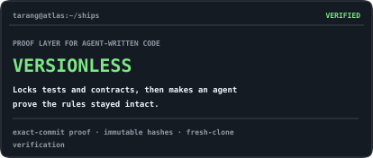
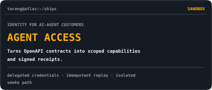
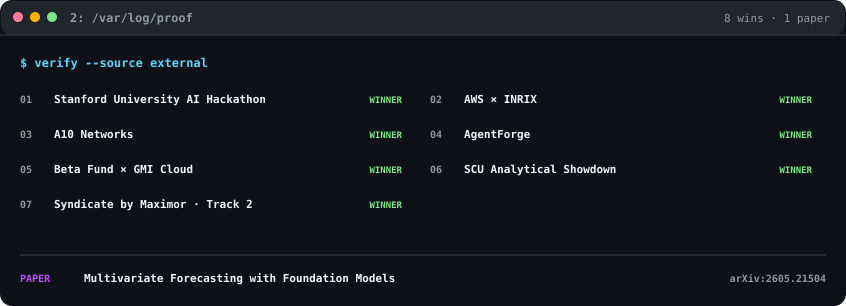

<a id="top"></a>

<p align="center"><picture><source media="(max-width: 600px), (min-width: 768px) and (max-width: 900px)" srcset="https://raw.githubusercontent.com/taranggoyal70/taranggoyal70/f70df3c3ec1abcbd558ece15e0870c01075ea0aa/assets/hero-phone.svg"><source media="(prefers-color-scheme: light)" srcset="https://raw.githubusercontent.com/taranggoyal70/taranggoyal70/f70df3c3ec1abcbd558ece15e0870c01075ea0aa/assets/hero-light.svg"></picture></p>

<p align="center"><a href="https://tarang-portfolio-pink.vercel.app"><picture><source media="(prefers-color-scheme: light)" srcset="assets/keys/portfolio-light.svg"></picture></a><a href="https://github.com/taranggoyal70?tab=repositories"><picture><source media="(prefers-color-scheme: light)" srcset="assets/keys/github-light.svg"></picture></a><a href="https://arxiv.org/abs/2605.21504"><picture><source media="(prefers-color-scheme: light)" srcset="assets/keys/paper-light.svg"></picture></a><a href="https://linkedin.com/in/tarang-goyal"><picture><source media="(prefers-color-scheme: light)" srcset="assets/keys/linkedin-light.svg"></picture></a><a href="mailto:taranggoyal2000@gmail.com"><picture><source media="(prefers-color-scheme: light)" srcset="assets/keys/email-light.svg"></picture></a><a href="#ships"><picture><source media="(prefers-color-scheme: light)" srcset="assets/keys/projects-light.svg"></picture></a><a href="https://locus-five-iota.vercel.app"><picture><source media="(prefers-color-scheme: light)" srcset="assets/keys/locus-light.svg"></picture></a></p>

<a id="ships"></a>
<p><a href="#proof"><picture><source media="(max-width: 600px)" srcset="assets/sections/ships.svg"><source media="(prefers-color-scheme: light)" srcset="assets/sections/ships-light.svg"></picture></a></p>

<p align="center"><a href="https://tickmark-kappa.vercel.app"><picture><source media="(max-width: 600px) and (prefers-color-scheme: light)" srcset="assets/ships/tickmark-phone-light.svg"><source media="(max-width: 600px)" srcset="assets/ships/tickmark-phone.svg"><source media="(prefers-color-scheme: light)" srcset="assets/ships/tickmark-light.svg"></picture></a><a href="https://locus-five-iota.vercel.app"><picture><source media="(max-width: 600px) and (prefers-color-scheme: light)" srcset="assets/ships/locus-phone-light.svg"><source media="(max-width: 600px)" srcset="assets/ships/locus-phone.svg"><source media="(prefers-color-scheme: light)" srcset="assets/ships/locus-light.svg"></picture></a><br>
<a href="https://github.com/taranggoyal70/versionless"><picture><source media="(max-width: 600px) and (prefers-color-scheme: light)" srcset="assets/ships/versionless-phone-light.svg"><source media="(max-width: 600px)" srcset="assets/ships/versionless-phone.svg"><source media="(prefers-color-scheme: light)" srcset="assets/ships/versionless-light.svg"></picture></a><a href="https://github.com/taranggoyal70/agent-access"><picture><source media="(max-width: 600px) and (prefers-color-scheme: light)" srcset="assets/ships/agent-access-phone-light.svg"><source media="(max-width: 600px)" srcset="assets/ships/agent-access-phone.svg"><source media="(prefers-color-scheme: light)" srcset="assets/ships/agent-access-light.svg"></picture></a></p>

<a id="proof"></a>
<p><a href="#etc"><picture><source media="(max-width: 600px)" srcset="assets/sections/proof.svg"><source media="(prefers-color-scheme: light)" srcset="assets/sections/proof-light.svg"></picture></a></p>

<picture><source media="(prefers-color-scheme: light)" srcset="assets/proof-light.svg"></picture>

<a id="etc"></a>
<p><a href="#top"><picture><source media="(max-width: 600px)" srcset="assets/sections/operator.svg"><source media="(prefers-color-scheme: light)" srcset="assets/sections/operator-light.svg"></picture></a></p>

<pre><b>tarang@atlas:~$ cat /etc/tarang</b>
role        AI product engineer / full-stack builder
mission     turn ambiguous problems into useful systems
agents      context, tools, guardrails, evals, MCP
stack       TypeScript Python React Next.js FastAPI Postgres AWS
research    Chronos-2 financial forecasting · arXiv:2605.21504
standard    talk to users · test the edges · ship the whole loop

<b>tarang@atlas:~$ ls /srv/evidence</b>
8_hackathon_wins/  48_repositories/  1_published_paper/  production_products/

<b>tarang@atlas:~$ crontab -l</b>
@daily      talk-to-users
@weekly     measure-before-claiming
@always     make-the-agent-show-its-work

<b>tarang@atlas:~$</b> <a href="mailto:taranggoyal2000@gmail.com">./start-a-conversation</a><span>_</span></pre>

<details>
<summary><code>tarang@atlas:~$ man tarang</code></summary>

```text
NAME
    tarang - AI product engineer who likes hard, ambiguous problems

SYNOPSIS
    tarang [problem] --build-end-to-end --talk-to-users --measure

DESCRIPTION
    Works across product, model behavior, frontend, backend, integrations,
    deployment, evaluation, and the uncomfortable gap between a demo and a
    system somebody can trust.

NOTES
    Eight-time hackathon and competition winner.
    Co-author of published research on financial forecasting foundation models.
    Sleep remains an optional dependency.
```

</details>

```text
tarang@atlas:~$ cat /opt/stack
typescript    5.x       load-bearing
python        3.x       the other load-bearing one
next.js       current   products, dashboards, and APIs
postgres      16        where the state actually lives
supabase      current   auth, persistence, and evidence
vercel        current   shipping lane
codex         current   coding-agent collaborator
tmux          -         home
```

<pre><b>tarang@atlas:~$ tmux detach</b>
[detached (from session builder)]
48 repositories · 8 wins · 1 paper · still shipping
<b>tarang@atlas:~$</b> <a href="#top">tmux a -t builder</a></pre>
