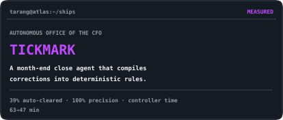

<a id="top"></a>
<!-- raw-source bonus: cat .plan, then email the word EVIDENCE. -->

<p align="center"><picture><source media="(max-width: 600px), (min-width: 768px) and (max-width: 900px)" srcset="assets/hero-phone.svg"><source media="(prefers-color-scheme: light)" srcset="assets/hero-light.svg"></picture></p>

<p align="center"><a href="man/tarang.1.md"><picture><source media="(max-width: 600px)" srcset="assets/chrome/key-f1.svg"><source media="(prefers-color-scheme: light)" srcset="assets/chrome/key-f1-light.svg"></picture></a><a href="https://locus-five-iota.vercel.app"><picture><source media="(max-width: 600px)" srcset="assets/chrome/key-f2.svg"><source media="(prefers-color-scheme: light)" srcset="assets/chrome/key-f2-light.svg"></picture></a><a href="mailto:taranggoyal2000@gmail.com"><picture><source media="(max-width: 600px)" srcset="assets/chrome/key-f3.svg"><source media="(prefers-color-scheme: light)" srcset="assets/chrome/key-f3-light.svg"></picture></a><a href="https://linkedin.com/in/tarang-goyal"><picture><source media="(max-width: 600px)" srcset="assets/chrome/key-f4.svg"><source media="(prefers-color-scheme: light)" srcset="assets/chrome/key-f4-light.svg"></picture></a><a href="https://arxiv.org/abs/2605.21504"><picture><source media="(max-width: 600px)" srcset="assets/chrome/key-f5.svg"><source media="(prefers-color-scheme: light)" srcset="assets/chrome/key-f5-light.svg"></picture></a><a href="https://github.com/taranggoyal70?tab=repositories"><picture><source media="(max-width: 600px)" srcset="assets/chrome/key-f6.svg"><source media="(prefers-color-scheme: light)" srcset="assets/chrome/key-f6-light.svg"></picture></a><a href="https://tarang-portfolio-pink.vercel.app"><picture><source media="(max-width: 600px)" srcset="assets/chrome/key-f7.svg"><source media="(prefers-color-scheme: light)" srcset="assets/chrome/key-f7-light.svg"></picture></a></p>

<a id="ships"></a>
<p><a href="#fsck"><picture><source media="(max-width: 600px)" srcset="assets/chrome/bar-1-phone.svg"><source media="(prefers-color-scheme: light)" srcset="assets/chrome/bar-1-light.svg"></picture></a></p>

<!-- HACKLOG:START -->
<p align="center"><a href="https://github.com/taranggoyal70/tickmark"><picture><source media="(max-width: 600px)" srcset="assets/ships/tickmark-phone.svg"><source media="(prefers-color-scheme: light)" srcset="assets/ships/tickmark-light.svg"></picture></a><a href="https://github.com/taranggoyal70/locus"><picture><source media="(max-width: 600px)" srcset="assets/ships/locus-phone.svg"><source media="(prefers-color-scheme: light)" srcset="assets/ships/locus-light.svg"></picture></a><br>
<a href="https://github.com/taranggoyal70/Morphic"><picture><source media="(max-width: 600px)" srcset="assets/ships/morphic-phone.svg"><source media="(prefers-color-scheme: light)" srcset="assets/ships/morphic-light.svg"></picture></a><a href="https://github.com/taranggoyal70/a10-ai-firewall-hackathon-2025"><picture><source media="(max-width: 600px)" srcset="assets/ships/ai-firewall-phone.svg"><source media="(prefers-color-scheme: light)" srcset="assets/ships/ai-firewall-light.svg"></picture></a></p>
<!-- HACKLOG:END -->

<a id="fsck"></a>
<p><a href="#etc"><picture><source media="(max-width: 600px)" srcset="assets/chrome/bar-2-phone.svg"><source media="(prefers-color-scheme: light)" srcset="assets/chrome/bar-2-light.svg"></picture></a></p>

<!-- FSCK:START -->
<p>
<picture><source media="(max-width: 600px)" srcset="assets/fsck/panel-0-phone.svg"><source media="(prefers-color-scheme: light)" srcset="assets/fsck/panel-0-light.svg"></picture><picture><source media="(max-width: 600px)" srcset="assets/fsck/tiles/dark/cols.svg"><source media="(prefers-color-scheme: light)" srcset="assets/fsck/tiles/light/cols.svg"></picture><br>
<picture><source media="(max-width: 600px)" srcset="assets/fsck/tiles/dark/r1.svg"><source media="(prefers-color-scheme: light)" srcset="assets/fsck/tiles/light/r1.svg"></picture><a href="https://github.com/taranggoyal70/taranggoyal70/issues/new?title=atlasd%7Cfsck%7CA1&amp;body=Submit+this+issue+as-is+to+scan+sector+A1+of+%2Fdev%2Fsda1.%0AThe+single-threaded+fsck+daemon+will+ack+with+an+eyes+reaction+and+redraw+the+board+in+about+a+minute."><picture><source media="(max-width: 600px)" srcset="assets/fsck/tiles/dark/hidden.svg"><source media="(prefers-color-scheme: light)" srcset="assets/fsck/tiles/light/hidden.svg"></picture></a><a href="https://github.com/taranggoyal70/taranggoyal70/issues/new?title=atlasd%7Cfsck%7CB1&amp;body=Submit+this+issue+as-is+to+scan+sector+B1+of+%2Fdev%2Fsda1.%0AThe+single-threaded+fsck+daemon+will+ack+with+an+eyes+reaction+and+redraw+the+board+in+about+a+minute."><picture><source media="(max-width: 600px)" srcset="assets/fsck/tiles/dark/hidden.svg"><source media="(prefers-color-scheme: light)" srcset="assets/fsck/tiles/light/hidden.svg"></picture></a><a href="https://github.com/taranggoyal70/taranggoyal70/issues/new?title=atlasd%7Cfsck%7CC1&amp;body=Submit+this+issue+as-is+to+scan+sector+C1+of+%2Fdev%2Fsda1.%0AThe+single-threaded+fsck+daemon+will+ack+with+an+eyes+reaction+and+redraw+the+board+in+about+a+minute."><picture><source media="(max-width: 600px)" srcset="assets/fsck/tiles/dark/hidden.svg"><source media="(prefers-color-scheme: light)" srcset="assets/fsck/tiles/light/hidden.svg"></picture></a><a href="https://github.com/taranggoyal70/taranggoyal70/issues/new?title=atlasd%7Cfsck%7CD1&amp;body=Submit+this+issue+as-is+to+scan+sector+D1+of+%2Fdev%2Fsda1.%0AThe+single-threaded+fsck+daemon+will+ack+with+an+eyes+reaction+and+redraw+the+board+in+about+a+minute."><picture><source media="(max-width: 600px)" srcset="assets/fsck/tiles/dark/hidden.svg"><source media="(prefers-color-scheme: light)" srcset="assets/fsck/tiles/light/hidden.svg"></picture></a><a href="https://github.com/taranggoyal70/taranggoyal70/issues/new?title=atlasd%7Cfsck%7CE1&amp;body=Submit+this+issue+as-is+to+scan+sector+E1+of+%2Fdev%2Fsda1.%0AThe+single-threaded+fsck+daemon+will+ack+with+an+eyes+reaction+and+redraw+the+board+in+about+a+minute."><picture><source media="(max-width: 600px)" srcset="assets/fsck/tiles/dark/hidden.svg"><source media="(prefers-color-scheme: light)" srcset="assets/fsck/tiles/light/hidden.svg"></picture></a><a href="https://github.com/taranggoyal70/taranggoyal70/issues/new?title=atlasd%7Cfsck%7CF1&amp;body=Submit+this+issue+as-is+to+scan+sector+F1+of+%2Fdev%2Fsda1.%0AThe+single-threaded+fsck+daemon+will+ack+with+an+eyes+reaction+and+redraw+the+board+in+about+a+minute."><picture><source media="(max-width: 600px)" srcset="assets/fsck/tiles/dark/hidden.svg"><source media="(prefers-color-scheme: light)" srcset="assets/fsck/tiles/light/hidden.svg"></picture></a><a href="https://github.com/taranggoyal70/taranggoyal70/issues/new?title=atlasd%7Cfsck%7CG1&amp;body=Submit+this+issue+as-is+to+scan+sector+G1+of+%2Fdev%2Fsda1.%0AThe+single-threaded+fsck+daemon+will+ack+with+an+eyes+reaction+and+redraw+the+board+in+about+a+minute."><picture><source media="(max-width: 600px)" srcset="assets/fsck/tiles/dark/hidden.svg"><source media="(prefers-color-scheme: light)" srcset="assets/fsck/tiles/light/hidden.svg"></picture></a><a href="https://github.com/taranggoyal70/taranggoyal70/issues/new?title=atlasd%7Cfsck%7CH1&amp;body=Submit+this+issue+as-is+to+scan+sector+H1+of+%2Fdev%2Fsda1.%0AThe+single-threaded+fsck+daemon+will+ack+with+an+eyes+reaction+and+redraw+the+board+in+about+a+minute."><picture><source media="(max-width: 600px)" srcset="assets/fsck/tiles/dark/hidden.svg"><source media="(prefers-color-scheme: light)" srcset="assets/fsck/tiles/light/hidden.svg"></picture></a><a href="https://github.com/taranggoyal70/taranggoyal70/issues/new?title=atlasd%7Cfsck%7CI1&amp;body=Submit+this+issue+as-is+to+scan+sector+I1+of+%2Fdev%2Fsda1.%0AThe+single-threaded+fsck+daemon+will+ack+with+an+eyes+reaction+and+redraw+the+board+in+about+a+minute."><picture><source media="(max-width: 600px)" srcset="assets/fsck/tiles/dark/hidden.svg"><source media="(prefers-color-scheme: light)" srcset="assets/fsck/tiles/light/hidden.svg"></picture></a><picture><source media="(max-width: 600px)" srcset="assets/fsck/tiles/dark/edge.svg"><source media="(prefers-color-scheme: light)" srcset="assets/fsck/tiles/light/edge.svg"></picture><br>
<picture><source media="(max-width: 600px)" srcset="assets/fsck/tiles/dark/r2.svg"><source media="(prefers-color-scheme: light)" srcset="assets/fsck/tiles/light/r2.svg"></picture><a href="https://github.com/taranggoyal70/taranggoyal70/issues/new?title=atlasd%7Cfsck%7CA2&amp;body=Submit+this+issue+as-is+to+scan+sector+A2+of+%2Fdev%2Fsda1.%0AThe+single-threaded+fsck+daemon+will+ack+with+an+eyes+reaction+and+redraw+the+board+in+about+a+minute."><picture><source media="(max-width: 600px)" srcset="assets/fsck/tiles/dark/hidden.svg"><source media="(prefers-color-scheme: light)" srcset="assets/fsck/tiles/light/hidden.svg"></picture></a><a href="https://github.com/taranggoyal70/taranggoyal70/issues/new?title=atlasd%7Cfsck%7CB2&amp;body=Submit+this+issue+as-is+to+scan+sector+B2+of+%2Fdev%2Fsda1.%0AThe+single-threaded+fsck+daemon+will+ack+with+an+eyes+reaction+and+redraw+the+board+in+about+a+minute."><picture><source media="(max-width: 600px)" srcset="assets/fsck/tiles/dark/hidden.svg"><source media="(prefers-color-scheme: light)" srcset="assets/fsck/tiles/light/hidden.svg"></picture></a><a href="https://github.com/taranggoyal70/taranggoyal70/issues/new?title=atlasd%7Cfsck%7CC2&amp;body=Submit+this+issue+as-is+to+scan+sector+C2+of+%2Fdev%2Fsda1.%0AThe+single-threaded+fsck+daemon+will+ack+with+an+eyes+reaction+and+redraw+the+board+in+about+a+minute."><picture><source media="(max-width: 600px)" srcset="assets/fsck/tiles/dark/hidden.svg"><source media="(prefers-color-scheme: light)" srcset="assets/fsck/tiles/light/hidden.svg"></picture></a><a href="https://github.com/taranggoyal70/taranggoyal70/issues/new?title=atlasd%7Cfsck%7CD2&amp;body=Submit+this+issue+as-is+to+scan+sector+D2+of+%2Fdev%2Fsda1.%0AThe+single-threaded+fsck+daemon+will+ack+with+an+eyes+reaction+and+redraw+the+board+in+about+a+minute."><picture><source media="(max-width: 600px)" srcset="assets/fsck/tiles/dark/hidden.svg"><source media="(prefers-color-scheme: light)" srcset="assets/fsck/tiles/light/hidden.svg"></picture></a><a href="https://github.com/taranggoyal70/taranggoyal70/issues/new?title=atlasd%7Cfsck%7CE2&amp;body=Submit+this+issue+as-is+to+scan+sector+E2+of+%2Fdev%2Fsda1.%0AThe+single-threaded+fsck+daemon+will+ack+with+an+eyes+reaction+and+redraw+the+board+in+about+a+minute."><picture><source media="(max-width: 600px)" srcset="assets/fsck/tiles/dark/hidden.svg"><source media="(prefers-color-scheme: light)" srcset="assets/fsck/tiles/light/hidden.svg"></picture></a><a href="https://github.com/taranggoyal70/taranggoyal70/issues/new?title=atlasd%7Cfsck%7CF2&amp;body=Submit+this+issue+as-is+to+scan+sector+F2+of+%2Fdev%2Fsda1.%0AThe+single-threaded+fsck+daemon+will+ack+with+an+eyes+reaction+and+redraw+the+board+in+about+a+minute."><picture><source media="(max-width: 600px)" srcset="assets/fsck/tiles/dark/hidden.svg"><source media="(prefers-color-scheme: light)" srcset="assets/fsck/tiles/light/hidden.svg"></picture></a><a href="https://github.com/taranggoyal70/taranggoyal70/issues/new?title=atlasd%7Cfsck%7CG2&amp;body=Submit+this+issue+as-is+to+scan+sector+G2+of+%2Fdev%2Fsda1.%0AThe+single-threaded+fsck+daemon+will+ack+with+an+eyes+reaction+and+redraw+the+board+in+about+a+minute."><picture><source media="(max-width: 600px)" srcset="assets/fsck/tiles/dark/hidden.svg"><source media="(prefers-color-scheme: light)" srcset="assets/fsck/tiles/light/hidden.svg"></picture></a><a href="https://github.com/taranggoyal70/taranggoyal70/issues/new?title=atlasd%7Cfsck%7CH2&amp;body=Submit+this+issue+as-is+to+scan+sector+H2+of+%2Fdev%2Fsda1.%0AThe+single-threaded+fsck+daemon+will+ack+with+an+eyes+reaction+and+redraw+the+board+in+about+a+minute."><picture><source media="(max-width: 600px)" srcset="assets/fsck/tiles/dark/hidden.svg"><source media="(prefers-color-scheme: light)" srcset="assets/fsck/tiles/light/hidden.svg"></picture></a><a href="https://github.com/taranggoyal70/taranggoyal70/issues/new?title=atlasd%7Cfsck%7CI2&amp;body=Submit+this+issue+as-is+to+scan+sector+I2+of+%2Fdev%2Fsda1.%0AThe+single-threaded+fsck+daemon+will+ack+with+an+eyes+reaction+and+redraw+the+board+in+about+a+minute."><picture><source media="(max-width: 600px)" srcset="assets/fsck/tiles/dark/hidden.svg"><source media="(prefers-color-scheme: light)" srcset="assets/fsck/tiles/light/hidden.svg"></picture></a><picture><source media="(max-width: 600px)" srcset="assets/fsck/tiles/dark/edge.svg"><source media="(prefers-color-scheme: light)" srcset="assets/fsck/tiles/light/edge.svg"></picture><br>
<picture><source media="(max-width: 600px)" srcset="assets/fsck/tiles/dark/r3.svg"><source media="(prefers-color-scheme: light)" srcset="assets/fsck/tiles/light/r3.svg"></picture><a href="https://github.com/taranggoyal70/taranggoyal70/issues/new?title=atlasd%7Cfsck%7CA3&amp;body=Submit+this+issue+as-is+to+scan+sector+A3+of+%2Fdev%2Fsda1.%0AThe+single-threaded+fsck+daemon+will+ack+with+an+eyes+reaction+and+redraw+the+board+in+about+a+minute."><picture><source media="(max-width: 600px)" srcset="assets/fsck/tiles/dark/hidden.svg"><source media="(prefers-color-scheme: light)" srcset="assets/fsck/tiles/light/hidden.svg"></picture></a><a href="https://github.com/taranggoyal70/taranggoyal70/issues/new?title=atlasd%7Cfsck%7CB3&amp;body=Submit+this+issue+as-is+to+scan+sector+B3+of+%2Fdev%2Fsda1.%0AThe+single-threaded+fsck+daemon+will+ack+with+an+eyes+reaction+and+redraw+the+board+in+about+a+minute."><picture><source media="(max-width: 600px)" srcset="assets/fsck/tiles/dark/hidden.svg"><source media="(prefers-color-scheme: light)" srcset="assets/fsck/tiles/light/hidden.svg"></picture></a><a href="https://github.com/taranggoyal70/taranggoyal70/issues/new?title=atlasd%7Cfsck%7CC3&amp;body=Submit+this+issue+as-is+to+scan+sector+C3+of+%2Fdev%2Fsda1.%0AThe+single-threaded+fsck+daemon+will+ack+with+an+eyes+reaction+and+redraw+the+board+in+about+a+minute."><picture><source media="(max-width: 600px)" srcset="assets/fsck/tiles/dark/hidden.svg"><source media="(prefers-color-scheme: light)" srcset="assets/fsck/tiles/light/hidden.svg"></picture></a><a href="https://github.com/taranggoyal70/taranggoyal70/issues/new?title=atlasd%7Cfsck%7CD3&amp;body=Submit+this+issue+as-is+to+scan+sector+D3+of+%2Fdev%2Fsda1.%0AThe+single-threaded+fsck+daemon+will+ack+with+an+eyes+reaction+and+redraw+the+board+in+about+a+minute."><picture><source media="(max-width: 600px)" srcset="assets/fsck/tiles/dark/hidden.svg"><source media="(prefers-color-scheme: light)" srcset="assets/fsck/tiles/light/hidden.svg"></picture></a><a href="https://github.com/taranggoyal70/taranggoyal70/issues/new?title=atlasd%7Cfsck%7CE3&amp;body=Submit+this+issue+as-is+to+scan+sector+E3+of+%2Fdev%2Fsda1.%0AThe+single-threaded+fsck+daemon+will+ack+with+an+eyes+reaction+and+redraw+the+board+in+about+a+minute."><picture><source media="(max-width: 600px)" srcset="assets/fsck/tiles/dark/hidden.svg"><source media="(prefers-color-scheme: light)" srcset="assets/fsck/tiles/light/hidden.svg"></picture></a><a href="https://github.com/taranggoyal70/taranggoyal70/issues/new?title=atlasd%7Cfsck%7CF3&amp;body=Submit+this+issue+as-is+to+scan+sector+F3+of+%2Fdev%2Fsda1.%0AThe+single-threaded+fsck+daemon+will+ack+with+an+eyes+reaction+and+redraw+the+board+in+about+a+minute."><picture><source media="(max-width: 600px)" srcset="assets/fsck/tiles/dark/hidden.svg"><source media="(prefers-color-scheme: light)" srcset="assets/fsck/tiles/light/hidden.svg"></picture></a><a href="https://github.com/taranggoyal70/taranggoyal70/issues/new?title=atlasd%7Cfsck%7CG3&amp;body=Submit+this+issue+as-is+to+scan+sector+G3+of+%2Fdev%2Fsda1.%0AThe+single-threaded+fsck+daemon+will+ack+with+an+eyes+reaction+and+redraw+the+board+in+about+a+minute."><picture><source media="(max-width: 600px)" srcset="assets/fsck/tiles/dark/hidden.svg"><source media="(prefers-color-scheme: light)" srcset="assets/fsck/tiles/light/hidden.svg"></picture></a><a href="https://github.com/taranggoyal70/taranggoyal70/issues/new?title=atlasd%7Cfsck%7CH3&amp;body=Submit+this+issue+as-is+to+scan+sector+H3+of+%2Fdev%2Fsda1.%0AThe+single-threaded+fsck+daemon+will+ack+with+an+eyes+reaction+and+redraw+the+board+in+about+a+minute."><picture><source media="(max-width: 600px)" srcset="assets/fsck/tiles/dark/hidden.svg"><source media="(prefers-color-scheme: light)" srcset="assets/fsck/tiles/light/hidden.svg"></picture></a><a href="https://github.com/taranggoyal70/taranggoyal70/issues/new?title=atlasd%7Cfsck%7CI3&amp;body=Submit+this+issue+as-is+to+scan+sector+I3+of+%2Fdev%2Fsda1.%0AThe+single-threaded+fsck+daemon+will+ack+with+an+eyes+reaction+and+redraw+the+board+in+about+a+minute."><picture><source media="(max-width: 600px)" srcset="assets/fsck/tiles/dark/hidden.svg"><source media="(prefers-color-scheme: light)" srcset="assets/fsck/tiles/light/hidden.svg"></picture></a><picture><source media="(max-width: 600px)" srcset="assets/fsck/tiles/dark/edge.svg"><source media="(prefers-color-scheme: light)" srcset="assets/fsck/tiles/light/edge.svg"></picture><br>
<picture><source media="(max-width: 600px)" srcset="assets/fsck/tiles/dark/r4.svg"><source media="(prefers-color-scheme: light)" srcset="assets/fsck/tiles/light/r4.svg"></picture><a href="https://github.com/taranggoyal70/taranggoyal70/issues/new?title=atlasd%7Cfsck%7CA4&amp;body=Submit+this+issue+as-is+to+scan+sector+A4+of+%2Fdev%2Fsda1.%0AThe+single-threaded+fsck+daemon+will+ack+with+an+eyes+reaction+and+redraw+the+board+in+about+a+minute."><picture><source media="(max-width: 600px)" srcset="assets/fsck/tiles/dark/hidden.svg"><source media="(prefers-color-scheme: light)" srcset="assets/fsck/tiles/light/hidden.svg"></picture></a><a href="https://github.com/taranggoyal70/taranggoyal70/issues/new?title=atlasd%7Cfsck%7CB4&amp;body=Submit+this+issue+as-is+to+scan+sector+B4+of+%2Fdev%2Fsda1.%0AThe+single-threaded+fsck+daemon+will+ack+with+an+eyes+reaction+and+redraw+the+board+in+about+a+minute."><picture><source media="(max-width: 600px)" srcset="assets/fsck/tiles/dark/hidden.svg"><source media="(prefers-color-scheme: light)" srcset="assets/fsck/tiles/light/hidden.svg"></picture></a><a href="https://github.com/taranggoyal70/taranggoyal70/issues/new?title=atlasd%7Cfsck%7CC4&amp;body=Submit+this+issue+as-is+to+scan+sector+C4+of+%2Fdev%2Fsda1.%0AThe+single-threaded+fsck+daemon+will+ack+with+an+eyes+reaction+and+redraw+the+board+in+about+a+minute."><picture><source media="(max-width: 600px)" srcset="assets/fsck/tiles/dark/hidden.svg"><source media="(prefers-color-scheme: light)" srcset="assets/fsck/tiles/light/hidden.svg"></picture></a><a href="https://github.com/taranggoyal70/taranggoyal70/issues/new?title=atlasd%7Cfsck%7CD4&amp;body=Submit+this+issue+as-is+to+scan+sector+D4+of+%2Fdev%2Fsda1.%0AThe+single-threaded+fsck+daemon+will+ack+with+an+eyes+reaction+and+redraw+the+board+in+about+a+minute."><picture><source media="(max-width: 600px)" srcset="assets/fsck/tiles/dark/hidden.svg"><source media="(prefers-color-scheme: light)" srcset="assets/fsck/tiles/light/hidden.svg"></picture></a><a href="https://github.com/taranggoyal70/taranggoyal70/issues/new?title=atlasd%7Cfsck%7CE4&amp;body=Submit+this+issue+as-is+to+scan+sector+E4+of+%2Fdev%2Fsda1.%0AThe+single-threaded+fsck+daemon+will+ack+with+an+eyes+reaction+and+redraw+the+board+in+about+a+minute."><picture><source media="(max-width: 600px)" srcset="assets/fsck/tiles/dark/hidden.svg"><source media="(prefers-color-scheme: light)" srcset="assets/fsck/tiles/light/hidden.svg"></picture></a><a href="https://github.com/taranggoyal70/taranggoyal70/issues/new?title=atlasd%7Cfsck%7CF4&amp;body=Submit+this+issue+as-is+to+scan+sector+F4+of+%2Fdev%2Fsda1.%0AThe+single-threaded+fsck+daemon+will+ack+with+an+eyes+reaction+and+redraw+the+board+in+about+a+minute."><picture><source media="(max-width: 600px)" srcset="assets/fsck/tiles/dark/hidden.svg"><source media="(prefers-color-scheme: light)" srcset="assets/fsck/tiles/light/hidden.svg"></picture></a><a href="https://github.com/taranggoyal70/taranggoyal70/issues/new?title=atlasd%7Cfsck%7CG4&amp;body=Submit+this+issue+as-is+to+scan+sector+G4+of+%2Fdev%2Fsda1.%0AThe+single-threaded+fsck+daemon+will+ack+with+an+eyes+reaction+and+redraw+the+board+in+about+a+minute."><picture><source media="(max-width: 600px)" srcset="assets/fsck/tiles/dark/hidden.svg"><source media="(prefers-color-scheme: light)" srcset="assets/fsck/tiles/light/hidden.svg"></picture></a><a href="https://github.com/taranggoyal70/taranggoyal70/issues/new?title=atlasd%7Cfsck%7CH4&amp;body=Submit+this+issue+as-is+to+scan+sector+H4+of+%2Fdev%2Fsda1.%0AThe+single-threaded+fsck+daemon+will+ack+with+an+eyes+reaction+and+redraw+the+board+in+about+a+minute."><picture><source media="(max-width: 600px)" srcset="assets/fsck/tiles/dark/hidden.svg"><source media="(prefers-color-scheme: light)" srcset="assets/fsck/tiles/light/hidden.svg"></picture></a><a href="https://github.com/taranggoyal70/taranggoyal70/issues/new?title=atlasd%7Cfsck%7CI4&amp;body=Submit+this+issue+as-is+to+scan+sector+I4+of+%2Fdev%2Fsda1.%0AThe+single-threaded+fsck+daemon+will+ack+with+an+eyes+reaction+and+redraw+the+board+in+about+a+minute."><picture><source media="(max-width: 600px)" srcset="assets/fsck/tiles/dark/hidden.svg"><source media="(prefers-color-scheme: light)" srcset="assets/fsck/tiles/light/hidden.svg"></picture></a><picture><source media="(max-width: 600px)" srcset="assets/fsck/tiles/dark/edge.svg"><source media="(prefers-color-scheme: light)" srcset="assets/fsck/tiles/light/edge.svg"></picture><br>
<picture><source media="(max-width: 600px)" srcset="assets/fsck/tiles/dark/r5.svg"><source media="(prefers-color-scheme: light)" srcset="assets/fsck/tiles/light/r5.svg"></picture><a href="https://github.com/taranggoyal70/taranggoyal70/issues/new?title=atlasd%7Cfsck%7CA5&amp;body=Submit+this+issue+as-is+to+scan+sector+A5+of+%2Fdev%2Fsda1.%0AThe+single-threaded+fsck+daemon+will+ack+with+an+eyes+reaction+and+redraw+the+board+in+about+a+minute."><picture><source media="(max-width: 600px)" srcset="assets/fsck/tiles/dark/hidden.svg"><source media="(prefers-color-scheme: light)" srcset="assets/fsck/tiles/light/hidden.svg"></picture></a><a href="https://github.com/taranggoyal70/taranggoyal70/issues/new?title=atlasd%7Cfsck%7CB5&amp;body=Submit+this+issue+as-is+to+scan+sector+B5+of+%2Fdev%2Fsda1.%0AThe+single-threaded+fsck+daemon+will+ack+with+an+eyes+reaction+and+redraw+the+board+in+about+a+minute."><picture><source media="(max-width: 600px)" srcset="assets/fsck/tiles/dark/hidden.svg"><source media="(prefers-color-scheme: light)" srcset="assets/fsck/tiles/light/hidden.svg"></picture></a><a href="https://github.com/taranggoyal70/taranggoyal70/issues/new?title=atlasd%7Cfsck%7CC5&amp;body=Submit+this+issue+as-is+to+scan+sector+C5+of+%2Fdev%2Fsda1.%0AThe+single-threaded+fsck+daemon+will+ack+with+an+eyes+reaction+and+redraw+the+board+in+about+a+minute."><picture><source media="(max-width: 600px)" srcset="assets/fsck/tiles/dark/hidden.svg"><source media="(prefers-color-scheme: light)" srcset="assets/fsck/tiles/light/hidden.svg"></picture></a><a href="https://github.com/taranggoyal70/taranggoyal70/issues/new?title=atlasd%7Cfsck%7CD5&amp;body=Submit+this+issue+as-is+to+scan+sector+D5+of+%2Fdev%2Fsda1.%0AThe+single-threaded+fsck+daemon+will+ack+with+an+eyes+reaction+and+redraw+the+board+in+about+a+minute."><picture><source media="(max-width: 600px)" srcset="assets/fsck/tiles/dark/hidden.svg"><source media="(prefers-color-scheme: light)" srcset="assets/fsck/tiles/light/hidden.svg"></picture></a><a href="https://github.com/taranggoyal70/taranggoyal70/issues/new?title=atlasd%7Cfsck%7CE5&amp;body=Submit+this+issue+as-is+to+scan+sector+E5+of+%2Fdev%2Fsda1.%0AThe+single-threaded+fsck+daemon+will+ack+with+an+eyes+reaction+and+redraw+the+board+in+about+a+minute."><picture><source media="(max-width: 600px)" srcset="assets/fsck/tiles/dark/hidden.svg"><source media="(prefers-color-scheme: light)" srcset="assets/fsck/tiles/light/hidden.svg"></picture></a><a href="https://github.com/taranggoyal70/taranggoyal70/issues/new?title=atlasd%7Cfsck%7CF5&amp;body=Submit+this+issue+as-is+to+scan+sector+F5+of+%2Fdev%2Fsda1.%0AThe+single-threaded+fsck+daemon+will+ack+with+an+eyes+reaction+and+redraw+the+board+in+about+a+minute."><picture><source media="(max-width: 600px)" srcset="assets/fsck/tiles/dark/hidden.svg"><source media="(prefers-color-scheme: light)" srcset="assets/fsck/tiles/light/hidden.svg"></picture></a><a href="https://github.com/taranggoyal70/taranggoyal70/issues/new?title=atlasd%7Cfsck%7CG5&amp;body=Submit+this+issue+as-is+to+scan+sector+G5+of+%2Fdev%2Fsda1.%0AThe+single-threaded+fsck+daemon+will+ack+with+an+eyes+reaction+and+redraw+the+board+in+about+a+minute."><picture><source media="(max-width: 600px)" srcset="assets/fsck/tiles/dark/hidden.svg"><source media="(prefers-color-scheme: light)" srcset="assets/fsck/tiles/light/hidden.svg"></picture></a><a href="https://github.com/taranggoyal70/taranggoyal70/issues/new?title=atlasd%7Cfsck%7CH5&amp;body=Submit+this+issue+as-is+to+scan+sector+H5+of+%2Fdev%2Fsda1.%0AThe+single-threaded+fsck+daemon+will+ack+with+an+eyes+reaction+and+redraw+the+board+in+about+a+minute."><picture><source media="(max-width: 600px)" srcset="assets/fsck/tiles/dark/hidden.svg"><source media="(prefers-color-scheme: light)" srcset="assets/fsck/tiles/light/hidden.svg"></picture></a><a href="https://github.com/taranggoyal70/taranggoyal70/issues/new?title=atlasd%7Cfsck%7CI5&amp;body=Submit+this+issue+as-is+to+scan+sector+I5+of+%2Fdev%2Fsda1.%0AThe+single-threaded+fsck+daemon+will+ack+with+an+eyes+reaction+and+redraw+the+board+in+about+a+minute."><picture><source media="(max-width: 600px)" srcset="assets/fsck/tiles/dark/hidden.svg"><source media="(prefers-color-scheme: light)" srcset="assets/fsck/tiles/light/hidden.svg"></picture></a><picture><source media="(max-width: 600px)" srcset="assets/fsck/tiles/dark/edge.svg"><source media="(prefers-color-scheme: light)" srcset="assets/fsck/tiles/light/edge.svg"></picture><br>
<picture><source media="(max-width: 600px)" srcset="assets/fsck/tiles/dark/r6.svg"><source media="(prefers-color-scheme: light)" srcset="assets/fsck/tiles/light/r6.svg"></picture><a href="https://github.com/taranggoyal70/taranggoyal70/issues/new?title=atlasd%7Cfsck%7CA6&amp;body=Submit+this+issue+as-is+to+scan+sector+A6+of+%2Fdev%2Fsda1.%0AThe+single-threaded+fsck+daemon+will+ack+with+an+eyes+reaction+and+redraw+the+board+in+about+a+minute."><picture><source media="(max-width: 600px)" srcset="assets/fsck/tiles/dark/hidden.svg"><source media="(prefers-color-scheme: light)" srcset="assets/fsck/tiles/light/hidden.svg"></picture></a><a href="https://github.com/taranggoyal70/taranggoyal70/issues/new?title=atlasd%7Cfsck%7CB6&amp;body=Submit+this+issue+as-is+to+scan+sector+B6+of+%2Fdev%2Fsda1.%0AThe+single-threaded+fsck+daemon+will+ack+with+an+eyes+reaction+and+redraw+the+board+in+about+a+minute."><picture><source media="(max-width: 600px)" srcset="assets/fsck/tiles/dark/hidden.svg"><source media="(prefers-color-scheme: light)" srcset="assets/fsck/tiles/light/hidden.svg"></picture></a><a href="https://github.com/taranggoyal70/taranggoyal70/issues/new?title=atlasd%7Cfsck%7CC6&amp;body=Submit+this+issue+as-is+to+scan+sector+C6+of+%2Fdev%2Fsda1.%0AThe+single-threaded+fsck+daemon+will+ack+with+an+eyes+reaction+and+redraw+the+board+in+about+a+minute."><picture><source media="(max-width: 600px)" srcset="assets/fsck/tiles/dark/hidden.svg"><source media="(prefers-color-scheme: light)" srcset="assets/fsck/tiles/light/hidden.svg"></picture></a><a href="https://github.com/taranggoyal70/taranggoyal70/issues/new?title=atlasd%7Cfsck%7CD6&amp;body=Submit+this+issue+as-is+to+scan+sector+D6+of+%2Fdev%2Fsda1.%0AThe+single-threaded+fsck+daemon+will+ack+with+an+eyes+reaction+and+redraw+the+board+in+about+a+minute."><picture><source media="(max-width: 600px)" srcset="assets/fsck/tiles/dark/hidden.svg"><source media="(prefers-color-scheme: light)" srcset="assets/fsck/tiles/light/hidden.svg"></picture></a><a href="https://github.com/taranggoyal70/taranggoyal70/issues/new?title=atlasd%7Cfsck%7CE6&amp;body=Submit+this+issue+as-is+to+scan+sector+E6+of+%2Fdev%2Fsda1.%0AThe+single-threaded+fsck+daemon+will+ack+with+an+eyes+reaction+and+redraw+the+board+in+about+a+minute."><picture><source media="(max-width: 600px)" srcset="assets/fsck/tiles/dark/hidden.svg"><source media="(prefers-color-scheme: light)" srcset="assets/fsck/tiles/light/hidden.svg"></picture></a><a href="https://github.com/taranggoyal70/taranggoyal70/issues/new?title=atlasd%7Cfsck%7CF6&amp;body=Submit+this+issue+as-is+to+scan+sector+F6+of+%2Fdev%2Fsda1.%0AThe+single-threaded+fsck+daemon+will+ack+with+an+eyes+reaction+and+redraw+the+board+in+about+a+minute."><picture><source media="(max-width: 600px)" srcset="assets/fsck/tiles/dark/hidden.svg"><source media="(prefers-color-scheme: light)" srcset="assets/fsck/tiles/light/hidden.svg"></picture></a><a href="https://github.com/taranggoyal70/taranggoyal70/issues/new?title=atlasd%7Cfsck%7CG6&amp;body=Submit+this+issue+as-is+to+scan+sector+G6+of+%2Fdev%2Fsda1.%0AThe+single-threaded+fsck+daemon+will+ack+with+an+eyes+reaction+and+redraw+the+board+in+about+a+minute."><picture><source media="(max-width: 600px)" srcset="assets/fsck/tiles/dark/hidden.svg"><source media="(prefers-color-scheme: light)" srcset="assets/fsck/tiles/light/hidden.svg"></picture></a><a href="https://github.com/taranggoyal70/taranggoyal70/issues/new?title=atlasd%7Cfsck%7CH6&amp;body=Submit+this+issue+as-is+to+scan+sector+H6+of+%2Fdev%2Fsda1.%0AThe+single-threaded+fsck+daemon+will+ack+with+an+eyes+reaction+and+redraw+the+board+in+about+a+minute."><picture><source media="(max-width: 600px)" srcset="assets/fsck/tiles/dark/hidden.svg"><source media="(prefers-color-scheme: light)" srcset="assets/fsck/tiles/light/hidden.svg"></picture></a><a href="https://github.com/taranggoyal70/taranggoyal70/issues/new?title=atlasd%7Cfsck%7CI6&amp;body=Submit+this+issue+as-is+to+scan+sector+I6+of+%2Fdev%2Fsda1.%0AThe+single-threaded+fsck+daemon+will+ack+with+an+eyes+reaction+and+redraw+the+board+in+about+a+minute."><picture><source media="(max-width: 600px)" srcset="assets/fsck/tiles/dark/hidden.svg"><source media="(prefers-color-scheme: light)" srcset="assets/fsck/tiles/light/hidden.svg"></picture></a><picture><source media="(max-width: 600px)" srcset="assets/fsck/tiles/dark/edge.svg"><source media="(prefers-color-scheme: light)" srcset="assets/fsck/tiles/light/edge.svg"></picture><br>
<picture><source media="(max-width: 600px)" srcset="assets/fsck/tiles/dark/r7.svg"><source media="(prefers-color-scheme: light)" srcset="assets/fsck/tiles/light/r7.svg"></picture><a href="https://github.com/taranggoyal70/taranggoyal70/issues/new?title=atlasd%7Cfsck%7CA7&amp;body=Submit+this+issue+as-is+to+scan+sector+A7+of+%2Fdev%2Fsda1.%0AThe+single-threaded+fsck+daemon+will+ack+with+an+eyes+reaction+and+redraw+the+board+in+about+a+minute."><picture><source media="(max-width: 600px)" srcset="assets/fsck/tiles/dark/hidden.svg"><source media="(prefers-color-scheme: light)" srcset="assets/fsck/tiles/light/hidden.svg"></picture></a><a href="https://github.com/taranggoyal70/taranggoyal70/issues/new?title=atlasd%7Cfsck%7CB7&amp;body=Submit+this+issue+as-is+to+scan+sector+B7+of+%2Fdev%2Fsda1.%0AThe+single-threaded+fsck+daemon+will+ack+with+an+eyes+reaction+and+redraw+the+board+in+about+a+minute."><picture><source media="(max-width: 600px)" srcset="assets/fsck/tiles/dark/hidden.svg"><source media="(prefers-color-scheme: light)" srcset="assets/fsck/tiles/light/hidden.svg"></picture></a><a href="https://github.com/taranggoyal70/taranggoyal70/issues/new?title=atlasd%7Cfsck%7CC7&amp;body=Submit+this+issue+as-is+to+scan+sector+C7+of+%2Fdev%2Fsda1.%0AThe+single-threaded+fsck+daemon+will+ack+with+an+eyes+reaction+and+redraw+the+board+in+about+a+minute."><picture><source media="(max-width: 600px)" srcset="assets/fsck/tiles/dark/hidden.svg"><source media="(prefers-color-scheme: light)" srcset="assets/fsck/tiles/light/hidden.svg"></picture></a><a href="https://github.com/taranggoyal70/taranggoyal70/issues/new?title=atlasd%7Cfsck%7CD7&amp;body=Submit+this+issue+as-is+to+scan+sector+D7+of+%2Fdev%2Fsda1.%0AThe+single-threaded+fsck+daemon+will+ack+with+an+eyes+reaction+and+redraw+the+board+in+about+a+minute."><picture><source media="(max-width: 600px)" srcset="assets/fsck/tiles/dark/hidden.svg"><source media="(prefers-color-scheme: light)" srcset="assets/fsck/tiles/light/hidden.svg"></picture></a><a href="https://github.com/taranggoyal70/taranggoyal70/issues/new?title=atlasd%7Cfsck%7CE7&amp;body=Submit+this+issue+as-is+to+scan+sector+E7+of+%2Fdev%2Fsda1.%0AThe+single-threaded+fsck+daemon+will+ack+with+an+eyes+reaction+and+redraw+the+board+in+about+a+minute."><picture><source media="(max-width: 600px)" srcset="assets/fsck/tiles/dark/hidden.svg"><source media="(prefers-color-scheme: light)" srcset="assets/fsck/tiles/light/hidden.svg"></picture></a><a href="https://github.com/taranggoyal70/taranggoyal70/issues/new?title=atlasd%7Cfsck%7CF7&amp;body=Submit+this+issue+as-is+to+scan+sector+F7+of+%2Fdev%2Fsda1.%0AThe+single-threaded+fsck+daemon+will+ack+with+an+eyes+reaction+and+redraw+the+board+in+about+a+minute."><picture><source media="(max-width: 600px)" srcset="assets/fsck/tiles/dark/hidden.svg"><source media="(prefers-color-scheme: light)" srcset="assets/fsck/tiles/light/hidden.svg"></picture></a><a href="https://github.com/taranggoyal70/taranggoyal70/issues/new?title=atlasd%7Cfsck%7CG7&amp;body=Submit+this+issue+as-is+to+scan+sector+G7+of+%2Fdev%2Fsda1.%0AThe+single-threaded+fsck+daemon+will+ack+with+an+eyes+reaction+and+redraw+the+board+in+about+a+minute."><picture><source media="(max-width: 600px)" srcset="assets/fsck/tiles/dark/hidden.svg"><source media="(prefers-color-scheme: light)" srcset="assets/fsck/tiles/light/hidden.svg"></picture></a><a href="https://github.com/taranggoyal70/taranggoyal70/issues/new?title=atlasd%7Cfsck%7CH7&amp;body=Submit+this+issue+as-is+to+scan+sector+H7+of+%2Fdev%2Fsda1.%0AThe+single-threaded+fsck+daemon+will+ack+with+an+eyes+reaction+and+redraw+the+board+in+about+a+minute."><picture><source media="(max-width: 600px)" srcset="assets/fsck/tiles/dark/hidden.svg"><source media="(prefers-color-scheme: light)" srcset="assets/fsck/tiles/light/hidden.svg"></picture></a><a href="https://github.com/taranggoyal70/taranggoyal70/issues/new?title=atlasd%7Cfsck%7CI7&amp;body=Submit+this+issue+as-is+to+scan+sector+I7+of+%2Fdev%2Fsda1.%0AThe+single-threaded+fsck+daemon+will+ack+with+an+eyes+reaction+and+redraw+the+board+in+about+a+minute."><picture><source media="(max-width: 600px)" srcset="assets/fsck/tiles/dark/hidden.svg"><source media="(prefers-color-scheme: light)" srcset="assets/fsck/tiles/light/hidden.svg"></picture></a><picture><source media="(max-width: 600px)" srcset="assets/fsck/tiles/dark/edge.svg"><source media="(prefers-color-scheme: light)" srcset="assets/fsck/tiles/light/edge.svg"></picture><br>
<picture><source media="(max-width: 600px)" srcset="assets/fsck/tiles/dark/r8.svg"><source media="(prefers-color-scheme: light)" srcset="assets/fsck/tiles/light/r8.svg"></picture><a href="https://github.com/taranggoyal70/taranggoyal70/issues/new?title=atlasd%7Cfsck%7CA8&amp;body=Submit+this+issue+as-is+to+scan+sector+A8+of+%2Fdev%2Fsda1.%0AThe+single-threaded+fsck+daemon+will+ack+with+an+eyes+reaction+and+redraw+the+board+in+about+a+minute."><picture><source media="(max-width: 600px)" srcset="assets/fsck/tiles/dark/hidden.svg"><source media="(prefers-color-scheme: light)" srcset="assets/fsck/tiles/light/hidden.svg"></picture></a><a href="https://github.com/taranggoyal70/taranggoyal70/issues/new?title=atlasd%7Cfsck%7CB8&amp;body=Submit+this+issue+as-is+to+scan+sector+B8+of+%2Fdev%2Fsda1.%0AThe+single-threaded+fsck+daemon+will+ack+with+an+eyes+reaction+and+redraw+the+board+in+about+a+minute."><picture><source media="(max-width: 600px)" srcset="assets/fsck/tiles/dark/hidden.svg"><source media="(prefers-color-scheme: light)" srcset="assets/fsck/tiles/light/hidden.svg"></picture></a><a href="https://github.com/taranggoyal70/taranggoyal70/issues/new?title=atlasd%7Cfsck%7CC8&amp;body=Submit+this+issue+as-is+to+scan+sector+C8+of+%2Fdev%2Fsda1.%0AThe+single-threaded+fsck+daemon+will+ack+with+an+eyes+reaction+and+redraw+the+board+in+about+a+minute."><picture><source media="(max-width: 600px)" srcset="assets/fsck/tiles/dark/hidden.svg"><source media="(prefers-color-scheme: light)" srcset="assets/fsck/tiles/light/hidden.svg"></picture></a><a href="https://github.com/taranggoyal70/taranggoyal70/issues/new?title=atlasd%7Cfsck%7CD8&amp;body=Submit+this+issue+as-is+to+scan+sector+D8+of+%2Fdev%2Fsda1.%0AThe+single-threaded+fsck+daemon+will+ack+with+an+eyes+reaction+and+redraw+the+board+in+about+a+minute."><picture><source media="(max-width: 600px)" srcset="assets/fsck/tiles/dark/hidden.svg"><source media="(prefers-color-scheme: light)" srcset="assets/fsck/tiles/light/hidden.svg"></picture></a><a href="https://github.com/taranggoyal70/taranggoyal70/issues/new?title=atlasd%7Cfsck%7CE8&amp;body=Submit+this+issue+as-is+to+scan+sector+E8+of+%2Fdev%2Fsda1.%0AThe+single-threaded+fsck+daemon+will+ack+with+an+eyes+reaction+and+redraw+the+board+in+about+a+minute."><picture><source media="(max-width: 600px)" srcset="assets/fsck/tiles/dark/hidden.svg"><source media="(prefers-color-scheme: light)" srcset="assets/fsck/tiles/light/hidden.svg"></picture></a><a href="https://github.com/taranggoyal70/taranggoyal70/issues/new?title=atlasd%7Cfsck%7CF8&amp;body=Submit+this+issue+as-is+to+scan+sector+F8+of+%2Fdev%2Fsda1.%0AThe+single-threaded+fsck+daemon+will+ack+with+an+eyes+reaction+and+redraw+the+board+in+about+a+minute."><picture><source media="(max-width: 600px)" srcset="assets/fsck/tiles/dark/hidden.svg"><source media="(prefers-color-scheme: light)" srcset="assets/fsck/tiles/light/hidden.svg"></picture></a><a href="https://github.com/taranggoyal70/taranggoyal70/issues/new?title=atlasd%7Cfsck%7CG8&amp;body=Submit+this+issue+as-is+to+scan+sector+G8+of+%2Fdev%2Fsda1.%0AThe+single-threaded+fsck+daemon+will+ack+with+an+eyes+reaction+and+redraw+the+board+in+about+a+minute."><picture><source media="(max-width: 600px)" srcset="assets/fsck/tiles/dark/hidden.svg"><source media="(prefers-color-scheme: light)" srcset="assets/fsck/tiles/light/hidden.svg"></picture></a><a href="https://github.com/taranggoyal70/taranggoyal70/issues/new?title=atlasd%7Cfsck%7CH8&amp;body=Submit+this+issue+as-is+to+scan+sector+H8+of+%2Fdev%2Fsda1.%0AThe+single-threaded+fsck+daemon+will+ack+with+an+eyes+reaction+and+redraw+the+board+in+about+a+minute."><picture><source media="(max-width: 600px)" srcset="assets/fsck/tiles/dark/hidden.svg"><source media="(prefers-color-scheme: light)" srcset="assets/fsck/tiles/light/hidden.svg"></picture></a><a href="https://github.com/taranggoyal70/taranggoyal70/issues/new?title=atlasd%7Cfsck%7CI8&amp;body=Submit+this+issue+as-is+to+scan+sector+I8+of+%2Fdev%2Fsda1.%0AThe+single-threaded+fsck+daemon+will+ack+with+an+eyes+reaction+and+redraw+the+board+in+about+a+minute."><picture><source media="(max-width: 600px)" srcset="assets/fsck/tiles/dark/hidden.svg"><source media="(prefers-color-scheme: light)" srcset="assets/fsck/tiles/light/hidden.svg"></picture></a><picture><source media="(max-width: 600px)" srcset="assets/fsck/tiles/dark/edge.svg"><source media="(prefers-color-scheme: light)" srcset="assets/fsck/tiles/light/edge.svg"></picture><br>
<picture><source media="(max-width: 600px)" srcset="assets/fsck/tiles/dark/r9.svg"><source media="(prefers-color-scheme: light)" srcset="assets/fsck/tiles/light/r9.svg"></picture><a href="https://github.com/taranggoyal70/taranggoyal70/issues/new?title=atlasd%7Cfsck%7CA9&amp;body=Submit+this+issue+as-is+to+scan+sector+A9+of+%2Fdev%2Fsda1.%0AThe+single-threaded+fsck+daemon+will+ack+with+an+eyes+reaction+and+redraw+the+board+in+about+a+minute."><picture><source media="(max-width: 600px)" srcset="assets/fsck/tiles/dark/hidden.svg"><source media="(prefers-color-scheme: light)" srcset="assets/fsck/tiles/light/hidden.svg"></picture></a><a href="https://github.com/taranggoyal70/taranggoyal70/issues/new?title=atlasd%7Cfsck%7CB9&amp;body=Submit+this+issue+as-is+to+scan+sector+B9+of+%2Fdev%2Fsda1.%0AThe+single-threaded+fsck+daemon+will+ack+with+an+eyes+reaction+and+redraw+the+board+in+about+a+minute."><picture><source media="(max-width: 600px)" srcset="assets/fsck/tiles/dark/hidden.svg"><source media="(prefers-color-scheme: light)" srcset="assets/fsck/tiles/light/hidden.svg"></picture></a><a href="https://github.com/taranggoyal70/taranggoyal70/issues/new?title=atlasd%7Cfsck%7CC9&amp;body=Submit+this+issue+as-is+to+scan+sector+C9+of+%2Fdev%2Fsda1.%0AThe+single-threaded+fsck+daemon+will+ack+with+an+eyes+reaction+and+redraw+the+board+in+about+a+minute."><picture><source media="(max-width: 600px)" srcset="assets/fsck/tiles/dark/hidden.svg"><source media="(prefers-color-scheme: light)" srcset="assets/fsck/tiles/light/hidden.svg"></picture></a><a href="https://github.com/taranggoyal70/taranggoyal70/issues/new?title=atlasd%7Cfsck%7CD9&amp;body=Submit+this+issue+as-is+to+scan+sector+D9+of+%2Fdev%2Fsda1.%0AThe+single-threaded+fsck+daemon+will+ack+with+an+eyes+reaction+and+redraw+the+board+in+about+a+minute."><picture><source media="(max-width: 600px)" srcset="assets/fsck/tiles/dark/hidden.svg"><source media="(prefers-color-scheme: light)" srcset="assets/fsck/tiles/light/hidden.svg"></picture></a><a href="https://github.com/taranggoyal70/taranggoyal70/issues/new?title=atlasd%7Cfsck%7CE9&amp;body=Submit+this+issue+as-is+to+scan+sector+E9+of+%2Fdev%2Fsda1.%0AThe+single-threaded+fsck+daemon+will+ack+with+an+eyes+reaction+and+redraw+the+board+in+about+a+minute."><picture><source media="(max-width: 600px)" srcset="assets/fsck/tiles/dark/hidden.svg"><source media="(prefers-color-scheme: light)" srcset="assets/fsck/tiles/light/hidden.svg"></picture></a><a href="https://github.com/taranggoyal70/taranggoyal70/issues/new?title=atlasd%7Cfsck%7CF9&amp;body=Submit+this+issue+as-is+to+scan+sector+F9+of+%2Fdev%2Fsda1.%0AThe+single-threaded+fsck+daemon+will+ack+with+an+eyes+reaction+and+redraw+the+board+in+about+a+minute."><picture><source media="(max-width: 600px)" srcset="assets/fsck/tiles/dark/hidden.svg"><source media="(prefers-color-scheme: light)" srcset="assets/fsck/tiles/light/hidden.svg"></picture></a><a href="https://github.com/taranggoyal70/taranggoyal70/issues/new?title=atlasd%7Cfsck%7CG9&amp;body=Submit+this+issue+as-is+to+scan+sector+G9+of+%2Fdev%2Fsda1.%0AThe+single-threaded+fsck+daemon+will+ack+with+an+eyes+reaction+and+redraw+the+board+in+about+a+minute."><picture><source media="(max-width: 600px)" srcset="assets/fsck/tiles/dark/hidden.svg"><source media="(prefers-color-scheme: light)" srcset="assets/fsck/tiles/light/hidden.svg"></picture></a><a href="https://github.com/taranggoyal70/taranggoyal70/issues/new?title=atlasd%7Cfsck%7CH9&amp;body=Submit+this+issue+as-is+to+scan+sector+H9+of+%2Fdev%2Fsda1.%0AThe+single-threaded+fsck+daemon+will+ack+with+an+eyes+reaction+and+redraw+the+board+in+about+a+minute."><picture><source media="(max-width: 600px)" srcset="assets/fsck/tiles/dark/hidden.svg"><source media="(prefers-color-scheme: light)" srcset="assets/fsck/tiles/light/hidden.svg"></picture></a><a href="https://github.com/taranggoyal70/taranggoyal70/issues/new?title=atlasd%7Cfsck%7CI9&amp;body=Submit+this+issue+as-is+to+scan+sector+I9+of+%2Fdev%2Fsda1.%0AThe+single-threaded+fsck+daemon+will+ack+with+an+eyes+reaction+and+redraw+the+board+in+about+a+minute."><picture><source media="(max-width: 600px)" srcset="assets/fsck/tiles/dark/hidden.svg"><source media="(prefers-color-scheme: light)" srcset="assets/fsck/tiles/light/hidden.svg"></picture></a><picture><source media="(max-width: 600px)" srcset="assets/fsck/tiles/dark/edge.svg"><source media="(prefers-color-scheme: light)" srcset="assets/fsck/tiles/light/edge.svg"></picture><br>
<picture><source media="(max-width: 600px)" srcset="assets/fsck/tiles/dark/base.svg"><source media="(prefers-color-scheme: light)" srcset="assets/fsck/tiles/light/base.svg"></picture><br clear="all">
</p>

<p>
<a href="https://github.com/taranggoyal70/taranggoyal70/issues/new?title=atlasd%7Cbutton&amp;body=Submit+this+issue+as-is.+You+were+told."><picture><source media="(max-width: 600px)" srcset="assets/fsck/button.svg"><source media="(prefers-color-scheme: light)" srcset="assets/fsck/button-light.svg"></picture></a>
</p>
<!-- FSCK:END -->

<a id="etc"></a>
<p><a href="#top"><picture><source media="(max-width: 600px)" srcset="assets/chrome/bar-3-phone.svg"><source media="(prefers-color-scheme: light)" srcset="assets/chrome/bar-3-light.svg"></picture></a></p>

<pre><b>tarang@atlas:~$ crontab -l</b><!-- CRONTAB:START -->
CRON_TZ=UTC
@reboot        <a href=".github/workflows/atlasd-ops.yaml">atlasd-ops.yaml</a>       # visitor input: fsck, the button
17 15 * * 1,4  <a href=".github/workflows/profile-summary.yaml">profile-summary.yaml</a>  # an LLM rewrites the boot screen
41 14 * * 6    <a href=".github/workflows/terminal-hero.yaml">terminal-hero.yaml</a>    # reroll the POST (1-in-8: panic)
<!-- CRONTAB:END --></pre>

<pre><b>tarang@atlas:~$ tail -n 4 /etc/passwd</b><!-- PASSWD:START -->
sleep:x:997:997:optional dependency:/nonexistent:/usr/sbin/nologin
atlasd:x:998:998:ATLASD daemon:/var/lib/atlasd:/usr/sbin/nologin
tarang:x:999:100:Tarang Goyal,,,:/home/tarang:/usr/bin/zsh
guest:x:1000:100:next stargazer:/home/guest:/usr/sbin/nologin
<b>tarang@atlas:~$ # uid 1001 is unclaimed. <a href="https://github.com/taranggoyal70/taranggoyal70">star this repo</a> to claim it.</b>
<!-- PASSWD:END --></pre>

<details>
<summary><code>tarang@atlas:~$ ls /mnt</code></summary>

<pre><b>tarang@atlas:~$ file /mnt/* /mnt/.plan</b>
/mnt/<a href="README.md.bak">README.md.bak</a>: first draft, corporate voice. kept as evidence
/mnt/<a href="man/tarang.1.md">tarang.1</a>:        manual page. has a BUGS section legal made me keep
/mnt/lander.stl:    ATLASD descent module. drag to rotate (below)
/mnt/pkg.list:      what is installed, and why (below)
/mnt/<a href=".plan">.plan</a>:         plain text. the actual changelog</pre>

```text
tarang@atlas:~$ cat /mnt/pkg.list
typescript    5.x        (load-bearing)
python        3.12       (the other load-bearing one)
react         ∞          (cannot uninstall, dependency of everything)
next.js       latest     (see: react)
fastapi       latest     (default answer to most questions)
postgres      16         (where the state actually lives)
elevenlabs    -          (hackathon-critical)
pytorch       2.x        (installed for one weekend, kept forever)
ffmpeg        any        (do not ask what it is wired into)
tmux          -          (home. you are in it)

# warning: optional dependency 'sleep' is not installed
```

```stl
solid atlasd_lander
facet normal 0.000 0.749 0.662
 outer loop
  vertex 7.07 7.07 14.00
  vertex -7.07 7.07 14.00
  vertex 0.00 0.00 22.00
 endloop
endfacet
facet normal 0.000 0.749 -0.662
 outer loop
  vertex -7.07 7.07 14.00
  vertex 7.07 7.07 14.00
  vertex 0.00 0.00 6.00
 endloop
endfacet
facet normal -0.749 0.000 0.662
 outer loop
  vertex -7.07 7.07 14.00
  vertex -7.07 -7.07 14.00
  vertex 0.00 0.00 22.00
 endloop
endfacet
facet normal -0.749 0.000 -0.662
 outer loop
  vertex -7.07 -7.07 14.00
  vertex -7.07 7.07 14.00
  vertex 0.00 0.00 6.00
 endloop
endfacet
facet normal -0.000 -0.749 0.662
 outer loop
  vertex -7.07 -7.07 14.00
  vertex 7.07 -7.07 14.00
  vertex 0.00 0.00 22.00
 endloop
endfacet
facet normal -0.000 -0.749 -0.662
 outer loop
  vertex 7.07 -7.07 14.00
  vertex -7.07 -7.07 14.00
  vertex 0.00 0.00 6.00
 endloop
endfacet
facet normal 0.749 -0.000 0.662
 outer loop
  vertex 7.07 -7.07 14.00
  vertex 7.07 7.07 14.00
  vertex 0.00 0.00 22.00
 endloop
endfacet
facet normal 0.749 -0.000 -0.662
 outer loop
  vertex 7.07 7.07 14.00
  vertex 7.07 -7.07 14.00
  vertex 0.00 0.00 6.00
 endloop
endfacet
facet normal 0.000 0.000 1.000
 outer loop
  vertex -8.00 -8.00 10.00
  vertex 8.00 -8.00 10.00
  vertex 8.00 8.00 10.00
 endloop
endfacet
facet normal 0.000 0.000 1.000
 outer loop
  vertex -8.00 -8.00 10.00
  vertex 8.00 8.00 10.00
  vertex -8.00 8.00 10.00
 endloop
endfacet
facet normal 0.000 0.000 -1.000
 outer loop
  vertex -8.00 -8.00 6.00
  vertex -8.00 8.00 6.00
  vertex 8.00 8.00 6.00
 endloop
endfacet
facet normal 0.000 0.000 -1.000
 outer loop
  vertex -8.00 -8.00 6.00
  vertex 8.00 8.00 6.00
  vertex 8.00 -8.00 6.00
 endloop
endfacet
facet normal 0.000 -1.000 0.000
 outer loop
  vertex -8.00 -8.00 6.00
  vertex 8.00 -8.00 6.00
  vertex 8.00 -8.00 10.00
 endloop
endfacet
facet normal 0.000 -1.000 0.000
 outer loop
  vertex -8.00 -8.00 6.00
  vertex 8.00 -8.00 10.00
  vertex -8.00 -8.00 10.00
 endloop
endfacet
facet normal 1.000 0.000 0.000
 outer loop
  vertex 8.00 -8.00 6.00
  vertex 8.00 8.00 6.00
  vertex 8.00 8.00 10.00
 endloop
endfacet
facet normal 1.000 0.000 0.000
 outer loop
  vertex 8.00 -8.00 6.00
  vertex 8.00 8.00 10.00
  vertex 8.00 -8.00 10.00
 endloop
endfacet
facet normal 0.000 1.000 0.000
 outer loop
  vertex 8.00 8.00 6.00
  vertex -8.00 8.00 6.00
  vertex -8.00 8.00 10.00
 endloop
endfacet
facet normal 0.000 1.000 0.000
 outer loop
  vertex 8.00 8.00 6.00
  vertex -8.00 8.00 10.00
  vertex 8.00 8.00 10.00
 endloop
endfacet
facet normal -1.000 0.000 0.000
 outer loop
  vertex -8.00 8.00 6.00
  vertex -8.00 -8.00 6.00
  vertex -8.00 -8.00 10.00
 endloop
endfacet
facet normal -1.000 0.000 0.000
 outer loop
  vertex -8.00 8.00 6.00
  vertex -8.00 -8.00 10.00
  vertex -8.00 8.00 10.00
 endloop
endfacet
facet normal 0.000 0.753 0.659
 outer loop
  vertex 7.00 7.00 8.00
  vertex 14.00 14.00 0.00
  vertex 5.60 7.00 8.00
 endloop
endfacet
facet normal 0.753 0.000 0.659
 outer loop
  vertex 7.00 7.00 8.00
  vertex 7.00 5.60 8.00
  vertex 14.00 14.00 0.00
 endloop
endfacet
facet normal 0.000 0.000 1.000
 outer loop
  vertex 12.50 12.50 0.00
  vertex 15.50 12.50 0.00
  vertex 15.50 15.50 0.00
 endloop
endfacet
facet normal 0.000 0.000 1.000
 outer loop
  vertex 12.50 12.50 0.00
  vertex 15.50 15.50 0.00
  vertex 12.50 15.50 0.00
 endloop
endfacet
facet normal 0.000 0.753 -0.659
 outer loop
  vertex 7.00 -7.00 8.00
  vertex 14.00 -14.00 0.00
  vertex 5.60 -7.00 8.00
 endloop
endfacet
facet normal -0.753 0.000 -0.659
 outer loop
  vertex 7.00 -7.00 8.00
  vertex 7.00 -5.60 8.00
  vertex 14.00 -14.00 0.00
 endloop
endfacet
facet normal 0.000 0.000 1.000
 outer loop
  vertex 12.50 -15.50 0.00
  vertex 15.50 -15.50 0.00
  vertex 15.50 -12.50 0.00
 endloop
endfacet
facet normal 0.000 0.000 1.000
 outer loop
  vertex 12.50 -15.50 0.00
  vertex 15.50 -12.50 0.00
  vertex 12.50 -12.50 0.00
 endloop
endfacet
facet normal 0.000 -0.753 -0.659
 outer loop
  vertex -7.00 7.00 8.00
  vertex -14.00 14.00 0.00
  vertex -5.60 7.00 8.00
 endloop
endfacet
facet normal 0.753 0.000 -0.659
 outer loop
  vertex -7.00 7.00 8.00
  vertex -7.00 5.60 8.00
  vertex -14.00 14.00 0.00
 endloop
endfacet
facet normal 0.000 0.000 1.000
 outer loop
  vertex -15.50 12.50 0.00
  vertex -12.50 12.50 0.00
  vertex -12.50 15.50 0.00
 endloop
endfacet
facet normal 0.000 0.000 1.000
 outer loop
  vertex -15.50 12.50 0.00
  vertex -12.50 15.50 0.00
  vertex -15.50 15.50 0.00
 endloop
endfacet
facet normal 0.000 -0.753 0.659
 outer loop
  vertex -7.00 -7.00 8.00
  vertex -14.00 -14.00 0.00
  vertex -5.60 -7.00 8.00
 endloop
endfacet
facet normal -0.753 0.000 0.659
 outer loop
  vertex -7.00 -7.00 8.00
  vertex -7.00 -5.60 8.00
  vertex -14.00 -14.00 0.00
 endloop
endfacet
facet normal 0.000 0.000 1.000
 outer loop
  vertex -15.50 -15.50 0.00
  vertex -12.50 -15.50 0.00
  vertex -12.50 -12.50 0.00
 endloop
endfacet
facet normal 0.000 0.000 1.000
 outer loop
  vertex -15.50 -15.50 0.00
  vertex -12.50 -12.50 0.00
  vertex -15.50 -12.50 0.00
 endloop
endfacet
facet normal 0.000 -1.000 0.000
 outer loop
  vertex 0.00 0.00 22.00
  vertex 1.20 0.00 27.00
  vertex -1.20 0.00 27.00
 endloop
endfacet
facet normal 1.000 0.000 -0.000
 outer loop
  vertex 0.00 0.00 22.00
  vertex 0.00 1.20 27.00
  vertex 0.00 -1.20 27.00
 endloop
endfacet
endsolid atlasd_lander
```

</details>

```text
# also runs in your terminal. windows: use curl.exe, not the alias.
curl -sL https://raw.githubusercontent.com/taranggoyal70/taranggoyal70/main/tarang.ansi
```

<pre><b>tarang@atlas:~$ tmux detach</b>
[detached (from session atlas)]<!-- BOOT_ONELINER:START -->
atlas: 0 days since last spontaneous rewrite
<!-- BOOT_ONELINER:END --><!-- BUILD_PLATE:START -->
build 0 · compiled from local · the human is a contributor
<!-- BUILD_PLATE:END -->
<b>tarang@atlas:~$</b> <a href="#top">tmux a -t atlas</a>   # or: <a href="https://github.com/taranggoyal70/taranggoyal70/issues/new?title=sudo+make+me+a+sandwich">help</a>, <a href="https://github.com/taranggoyal70/taranggoyal70">source</a></pre>
